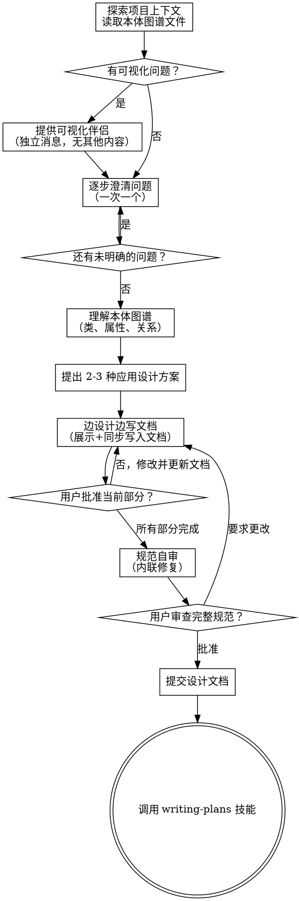

# 将想法头脑风暴为应用设计

通过自然协作对话帮助将想法转化为完整的应用设计和规范。**采用本体方法论**：基于已有的领域本体图谱（类、属性、关系），推导出应用架构设计和数据库表结构。

首先了解当前项目上下文和本体图谱，然后**通过对话逐步**收集关键信息，理解要构建什么后展示应用设计并获得用户批准。

<HARD-GATE>
在展示应用设计并获得用户批准之前，不要调用任何实现技能、编写任何代码、搭建任何项目或采取任何实现行动。这适用于每个项目，无论感知到的简单性如何。
</HARD-GATE>

## 反面模式："这太简单了，不需要设计"

每个项目都要经过这个流程。待办列表、单函数工具、配置更改——所有都是。"简单"项目是未经审查的假设导致最多浪费工作的地方。设计可以很短（真正简单的项目只需几句话），但你必须展示它并获得批准。

## 检查清单

你必须为以下每个项目创建任务并按顺序完成它们：

1. **探索项目上下文** — 检查文件、文档、最近的提交、**读取项目目录下的本体图谱文件**
2. **提供可视化伴侣**（如果主题将涉及可视化问题）— 这是独立的消息，不与澄清问题合并。见下方的可视化伴侣部分。
3. **逐步澄清问题** — 一次问一个关键问题，理解目的/约束/成功标准/应用范围，通过自然对话逐步明确需求；优先问最关键的问题，其余信息从上下文推断或在设计阶段确认
4. **理解本体图谱** — 读取并理解项目目录下已有的本体图谱（类、属性、关系）
5. **提出 2-3 种应用设计方案** — 附带权衡和你的建议
6. **边设计边写文档** — 基于本体图谱展示应用架构设计、数据库表设计、接口设计，**同时将每个部分写入设计文档** `docs/app-design.md`，按复杂度缩放展示各个部分，在每个部分完成后获得用户批准并更新文档
7. **规范自审** — 快速内联检查占位符、矛盾、歧义、范围（见下方）
8. **用户审查完整规范** — 在继续之前请用户审查完整的规范文件并提交
9. **过渡到实现** — 调用 writing-plans 技能创建实现计划

## 流程



**终端状态是调用 writing-plans。** 不要调用 frontend-design、mcp-builder 或任何其他实现技能。在头脑风暴之后，你唯一调用的技能是 writing-plans。

## 流程

**理解想法：**

- 首先检查当前项目状态（文件、文档、最近的提交）
- **读取项目目录下的本体图谱文件**（通常在项目根目录或 docs 目录下，如 `ontology.md`、`domain-model.md` 等）
- **读取项目技术规范**，了解技术栈约束，使设计方案在约束范围内展开：
  `/references/`
- 在问详细问题之前，评估范围：如果请求描述了多个独立的子系统（例如"构建带有聊天、文件存储、计费和分析的平台"），立即标记。不要花时间细化需要首先分解的项目的细节。
- 如果项目对于单个规范来说太大，帮助用户分解为子项目：有哪些独立的部分，它们如何关联，应该按什么顺序构建？然后通过正常的设计流程头脑风暴第一个子项目。每个子项目都有自己的规范 → 计划 → 实现周期。
- 对于适当范围的项目，**通过自然对话逐步澄清需求，一次问一个关键问题**，避免一次性抛出大量问题让用户感到压力
- **优先问最关键的问题**（目的、核心约束、成功标准），其余信息从项目上下文推断或在设计阶段与用户确认
- 尽可能使用多项选择题，但开放式问题也可以
- 重点关注：目的、约束、成功标准、本体范围边界
- 每次提问后等待用户回答，根据回答决定下一个问题，形成自然的对话流

**理解本体图谱（从已有文件读取）：**

项目目录下应该已经有本体图谱文件，读取并理解：

- **识别类（Class）**：领域中的核心概念/业务对象，如"用户"、"订单"、"商品"
- **识别属性（Property）**：每个类的数据属性，如用户的姓名、手机号
- **识别关系（Relation/Edge）**：类之间的关联，如"用户 → 下单 → 订单"、"订单 → 包含 → 商品"
  - 关系类型：一对一、一对多、多对多
  - 关系方向和语义（动词描述）
- **继承层次**：如果有父子类关系，理解继承结构
- 如果本体图谱不清晰或缺失，向用户确认本体图谱的位置或请求补充

**探索方法：**

- 提出 2-3 种不同的应用设计方案及其权衡
- 以对话方式呈现选项，附上你的建议和推理
- 以你推荐的选项开头并解释原因

**边设计边写文档（核心流程）：**

这是本技能的核心工作方式：**设计和文档编写是同步进行的，而不是分离的两个步骤。**

- 首先创建设计文档文件 `docs/app-design.md`
- 然后按以下顺序逐部分进行：
  1. **展示当前部分的设计**（如架构设计）
  2. **立即将该部分写入文档**（使用 Write 或 Edit 工具）
  3. **询问用户是否批准当前部分**
  4. 如果批准，继续下一部分；如果需要修改，更新设计和文档后再次确认
- 每个部分的复杂度决定其详细程度：简单的几句话，复杂的 200-300 字
- 涵盖的部分包括：
  - 基于本体的应用架构
  - 模块/组件划分
  - 数据流设计
  - 数据库设计（从本体推导，见下方规则）
  - 接口设计（API/UI）
  - 错误处理策略
  - 测试策略
- **关键原则**：用户在审查设计的同时也在审查文档，确保设计和文档始终保持一致

**数据库设计（从本体推导，见下方规则）：**

基于已读取的本体图谱,按照以下映射规则设计数据库表，在应用设计展示中包含每张表的完整定义，**并同步写入文档**。

**隔离和清晰度的应用设计：**

- 将应用系统分解为较小的单元（模块/组件/服务），每个单元都有清晰的目的，通过明确定义的接口通信，并且可以独立理解和测试
- 对于每个单元，你应该能够回答：它做什么，如何使用它，它依赖什么？
- 有人能否在不阅读其内部实现的情况下理解单元的作用？你能在不破坏消费者的情况下更改内部实现吗？如果不能，边界需要改进。
- 较小、边界清晰的单元也更容易让你处理——你能更好地一次理解代码，当文件专注时你的编辑更可靠。当文件变得过大时，这通常是它做得太多的信号。

**在现有代码库中工作：**

- 在提出更改之前探索当前结构。遵循现有模式。
- 如果现有代码有影响工作的问题（例如增长过大的文件、不清晰的边界、混乱的职责），在设计中包含有针对性的改进——就像好的开发者改进他们工作的代码一样。
- 不要提议无关的重构。专注于服务于当前目标的内容。

## 数据库设计规则（从本体推导）

设计中涉及数据库时，必须严格遵守以下规则：

### 从本体类到业务表

- 每个本体类（业务对象）对应一张业务表
- 类名转换为表名：驼峰转下划线（如 `UserInfo` → `user_info`）
- 可根据业务加前缀（如 `sys_`、`biz_`），与现有项目命名保持一致
- 抽象父类可不独立建表，属性下推到子类表；也可选单表继承（用 `type` 字段区分）

### 从本体关系（边）到关联设计

- **一对一关系** → 两种方案：合并到主表，或从表添加主表 id 字段（建唯一索引）
- **一对多关系** → 在"多"方表中添加"一"方的 id 字段（建普通索引），**不使用外键约束**
- **多对多关系** → 创建独立的**关联关系表**，包含：自增主键、两侧 id 字段、审计字段；在 (表1_id, 表2_id) 建唯一索引

### 必须遵守的数据库规范

**主键：**
- 每张表必须有 `id` 字段：`bigint unsigned NOT NULL AUTO_INCREMENT`，作为自增主键
- 禁止使用业务字段作为主键

**审计字段（每张表必须包含）：**
- `create_by`：varchar(64)，创建人
- `gmt_create`：datetime NOT NULL DEFAULT CURRENT_TIMESTAMP，创建时间
- `update_by`：varchar(64)，修改人
- `gmt_modified`：datetime NOT NULL DEFAULT CURRENT_TIMESTAMP ON UPDATE CURRENT_TIMESTAMP，修改时间

**禁止事项：**
- **禁止使用外键约束**，关联完整性由应用层保证
- 禁止使用 float 或 double，小数使用 decimal
- 禁止使用 MySQL 保留字作为字段名（如 desc、range、match 等）

**命名规范：**
- 表名、字段名必须小写字母+下划线，禁止数字开头
- 主键索引名：`pk_字段名`，唯一索引名：`uk_字段名`，普通索引名：`idx_字段名`
- 布尔/状态字段使用 `is_xxx` 命名，类型为 tinyint

**索引：**
- 业务唯一字段必须建唯一索引
- 关联字段（xxxId 类）必须建普通索引
- 单表索引不超过 5 个

### DDL 示例格式

```sql
CREATE TABLE `biz_order_info` (
  `id` bigint unsigned NOT NULL AUTO_INCREMENT COMMENT '主键ID',
  `order_no` varchar(64) NOT NULL COMMENT '订单号',
  `user_id` bigint unsigned NOT NULL COMMENT '用户ID',
  `status` tinyint NOT NULL DEFAULT '0' COMMENT '状态：0-待支付，1-已支付，2-已取消',
  `is_deleted` tinyint NOT NULL DEFAULT '0' COMMENT '是否删除：0-否，1-是',
  `create_by` varchar(64) DEFAULT NULL COMMENT '创建人',
  `gmt_create` datetime NOT NULL DEFAULT CURRENT_TIMESTAMP COMMENT '创建时间',
  `update_by` varchar(64) DEFAULT NULL COMMENT '修改人',
  `gmt_modified` datetime NOT NULL DEFAULT CURRENT_TIMESTAMP ON UPDATE CURRENT_TIMESTAMP COMMENT '修改时间',
  PRIMARY KEY (`id`) USING BTREE,
  UNIQUE KEY `uk_order_no` (`order_no`) USING BTREE,
  KEY `idx_user_id` (`user_id`) USING BTREE
) ENGINE=InnoDB DEFAULT CHARSET=utf8mb4 COLLATE=utf8mb4_unicode_ci COMMENT='订单信息表';
```

## 设计之后

**规范自审：**
完成所有设计部分并同步写入文档后，以全新的眼光审视完整的设计文档：

1. **占位符扫描：** 任何"TBD"、"TODO"、不完整的部分或模糊的需求？修复它们。
2. **内部一致性：** 任何部分是否相互矛盾？应用架构是否与功能描述匹配？
3. **范围检查：** 这是否足够专注于单个实现计划，还是需要分解？
4. **歧义检查：** 任何需求是否可以有两种不同的解释？如果是，选择一个并使其明确。
5. **数据库规范检查：** 每张表是否有自增主键、完整审计字段？是否有外键约束（不允许）？关联表是否从本体边正确推导？
6. **接口完整性检查：** API接口定义是否完整？输入输出是否明确？UI界面设计是否清晰？

内联修复任何问题。无需重新审查——只需修复并继续。

**用户审查关卡：**
规范审查循环通过后，在继续之前请用户审查完整的书面规范：

> "设计文档已完成并保存到 `<path>`。请审查完整的规范，在我们开始编写实现计划之前告诉我你是否想做任何更改。"

等待用户响应。如果他们要求更改，进行更改、更新文档并重新运行规范审查循环。只有在用户批准后才提交文档并继续。

**提交文档：**

- 用户批准后，将设计文档提交到 git
- 如果可用，使用 elements-of-style:writing-clearly-and-concisely 技能优化文档

**实现：**

- 调用 writing-plans 技能创建详细的实现计划
- 不要调用任何其他技能。writing-plans 是下一步。

## 关键原则

- **逐步对话** — 一次问一个关键问题，通过自然对话逐步明确需求，避免一次性抛出大量问题；优先问最关键的问题，其余信息从上下文推断或在设计阶段确认
- **首选多项选择** — 在可能时比开放式问题更容易回答
- **本体优先** — 基于已有的领域本体图谱，推导应用架构和数据库设计
- **边设计边写文档** — 设计和文档编写同步进行，每完成一个设计部分立即写入文档，确保设计与文档始终一致
- **严格遵循 YAGNI** — 从所有设计中删除不必要的功能
- **探索替代方案** — 在确定之前总是提出 2-3 种应用设计方案
- **增量验证** — 展示每个设计部分，在继续之前获得批准
- **保持灵活** — 当某些东西没有意义时返回并澄清

## 可视化伴侣

用于在头脑风暴期间展示模拟图、图表和可视化选项的基于浏览器的伴侣。作为工具可用——不是一种模式。接受伴侣意味着它可用于从可视化处理中受益的问题；这并不意味着每个问题都通过浏览器。

**提供伴侣：** 当你预期即将到来的问题将涉及可视化内容（模拟图、布局、图表、本体图谱可视化）时，提供一次同意：
> "我们正在处理的一些内容如果我在 Web 浏览器中向你展示可能更容易解释。我可以在进行时准备模拟图、图表、本体图谱、比较和其他可视化内容。这个功能仍然比较新，可能会消耗较多 token。想试试吗？（需要打开本地 URL）"

**此提供必须是其自己的消息。** 不要将其与澄清问题、上下文摘要或任何其他内容合并。消息应该只包含上述提供，没有其他内容。在继续之前等待用户响应。如果他们拒绝，继续仅文本的头脑风暴。

**每个问题的决定：** 即使用户接受，也要为每个问题决定是否使用浏览器或终端。测试：**用户通过看它是否比阅读它理解得更好？**

- **使用浏览器** 用于可视化的内容——模拟图、线框图、布局比较、架构图、本体图谱、ER图、并排可视化设计
- **使用终端** 用于文本内容——需求问题、概念选择、权衡列表、A/B/C/D 文本选项、范围决定

关于 UI 主题的问题不自动是可视化问题。"在这种情况下个性意味着什么？"是概念问题——使用终端。"哪个向导布局更好？"是可视化问题——使用浏览器。

如果他们同意伴侣，在继续之前阅读详细指南：
`skills/brainstorming/visual-companion.md`

## 本体方法论补充说明

**为什么采用本体方法论？**

本体方法论帮助我们从概念层面理解业务领域，建立清晰的领域模型，然后系统地推导出架构设计和数据库设计。这种自顶向下的方法避免了直接从需求跳到实现的盲目性，确保设计的一致性和完整性。

**本体图谱的位置：**

- 通常在项目根目录或 `docs/` 目录下
- 常见文件名：`ontology.md`、`domain-model.md`、`本体图谱.md` 等
- 如果找不到，询问用户本体图谱的位置

**本体图谱的表达方式：**

- 可能使用 Mermaid 类图（classDiagram）展示类、属性、关系
- 或使用文字列表：类 → 属性列表 → 关系列表
- 关系标注方向、类型（1:1、1:N、N:M）、语义（动词）

**从本体到实现的完整路径：**

1. **本体图谱**（概念模型）：类、属性、关系（已存在于项目中）
2. **架构设计**（逻辑模型）：模块、组件、接口、数据流
3. **数据库设计**（物理模型）：业务表（从类推导）+ 关联表（从边推导）
4. **实现计划**（代码层）：文件、函数、测试

这个路径确保从业务概念到技术实现的可追溯性。
