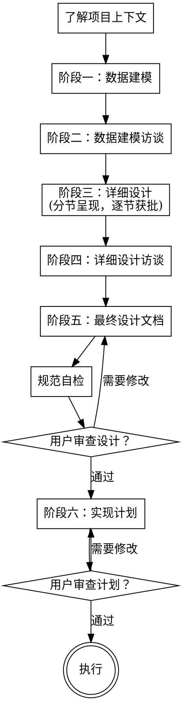

# BRD + Ontology → 数据建模与详细设计

## 概述

一个严格的流程，将 BRD + Ontology Schema 转化为生产级 MySQL DDL、详细设计文档和实现计划。内嵌了协作式探索（Brainstorming）和结构化实现计划编写（Writing Plans）的方法论，不依赖任何外部 skill 调用。

**核心原则：** 先出 DDL，再访谈挑战假设，再做详细设计，再访谈，最后出文档和实现计划。绝不可跳过阶段。

## 何时使用

- 你有 `brd.md` + `ontology_schema.json`，需要 MySQL DDL、设计文档和实现计划
- 你需要从业务需求出发做数据建模、架构设计和实现计划

## 检查清单

你必须为每个阶段创建任务并按顺序完成：

1. **了解项目上下文** — 读取 BRD + Ontology + 现有代码结构
2. **阶段一：数据建模** — 仅从 ontology 提取实体 → 初版 DDL
3. **阶段二：数据建模访谈** — 挑战 DDL，发现遗漏 → 精化 DDL
4. **阶段三：详细设计** — 架构、分层、API、流程 → 设计草稿（分节呈现，每节获批后再进入下一节）
5. **阶段四：详细设计访谈** — 验证设计，发现边界情况 → 精化设计
6. **阶段五：最终设计文档** — 汇总、自检、提交 → 设计文档
7. **用户审查** — 请用户审查设计文档 + 实现计划
8. **阶段六：实现计划** — 文件映射、任务分解、TDD 步骤 → 实现计划

## 流程



## 关键原则

- **一次一问** — 不要一次性抛出多个问题让用户不知所措
- **优先选择题** — 比开放式问题更容易回答
- **YAGNI 严格执行** — 从所有设计中剔除不必要的功能
- **探索替代方案** — 始终提出 2-3 种方案再定稿
- **增量验证** — 先呈现设计，获得批准后再推进
- **保持灵活** — 当某个地方说不通时，回去澄清
- **绝不跳过阶段** — 每个阶段必须完成才能进入下一个
- **设计隔离** — 将系统拆分为更小的单元，每个单元有单一明确职责，通过明确定义的接口通信，可以独立理解和测试

---

## 阶段零：了解项目上下文

**开始前声明：** "我正在使用 brd-ontology-to-design skill。开始阶段零：了解项目上下文。"

### 步骤

1. **读取 `brd.md`** — 理解业务背景、范围、功能需求、非功能需求、业务流程、业务规则
2. **读取 `ontology_schema.json`** — 理解对象、边、规则
3. **检查现有代码结构**（如果项目已存在代码）：
   - 查看目录结构、现有文件、文档
   - 如果有 git，查看近期提交了解项目活跃度
   - 了解已有技术栈和框架选择
4. **评估范围** — 如果项目过大（涵盖多个独立子系统），在开始任何设计前告知用户，建议拆分为多个子项目，每个子项目独立走完整流程

---

## 阶段一：数据建模 → 初版 MySQL DDL

**声明：** "开始阶段一：数据建模。"

> **注意：** 本阶段仅从 `ontology_schema.json` 提取实体，不参考 BRD 的业务细节。BRD 在后续阶段用于验证和补充。

### 步骤

1. **读取 ontology_schema.json：**
   - 提取所有 `objects`（核心对象 + 引用对象）
   - 提取所有 `edges`（实体关系）
   - 提取所有 `rules`（约束规则）

2. **映射实体到表：**
   - `type: "核心对象"` → 业务表
   - `type: "引用对象"` → 参考/字典表（小表，≤5 个字段）
   - ontology 边中 1:N 关系如需中间表（多对多）→ 创建关联表

3. **确定列类型**（ontology 类型 → MySQL 类型）：

   | Ontology 类型 | MySQL 类型 | 说明 |
   |---|---|---|
   | String | `VARCHAR(n)` 或 `CHAR(n)` | 编码用 `CHAR`，名称/描述用 `VARCHAR`，长度从上下文推断 |
   | Double | `DECIMAL(18,4)` | 数量和金额 — 绝不用 FLOAT/DOUBLE 处理金额/数量 |
   | Integer | `INT` 或 `BIGINT` | 版本号、计数 |
   | String (日期/时间) | `DATETIME` 或 `DATE` | 审计字段用 `DATETIME` |
   | String (枚举) | `VARCHAR(n)` + comment | 或用 `TINYINT` 配合字典表 |

4. **生成主键：**
   - ontology 中有复合键 → 复合 PK
   - ontology 中有单键字段 → 使用该字段作为 PK
   - 仅在自然键过宽不适合 FK 引用时，才添加 `BIGINT AUTO_INCREMENT` 代理主键

5. **从 `edges` 生成外键：**
   - 将每条 `N:1` 或 `1:N` 边映射为 FK 约束
   - 命名：`fk_<表>_<引用表>`

6. **生成索引：**
   - 每个 FK 列 → 索引
   - BRD 中查询条件的字段 → 索引
   - BRD 中的唯一约束 → 唯一索引

7. **将业务规则作为约束：**
   - `INV-*` → `CHECK` 约束或 `NOT NULL` + 触发器（MySQL 版本限制时）
   - 枚举值 → 列注释列出允许值
   - `CALC-*` → 在注释中记录；考虑生成列或触发器

8. **添加审计列：** 每个业务表都加 `updated_by VARCHAR(64)`，`updated_time DATETIME DEFAULT CURRENT_TIMESTAMP ON UPDATE CURRENT_TIMESTAMP`

9. **添加表和列注释：** 每个表和列都加中文 `COMMENT`

10. **输出 DDL：** 写入 `doc/YYYY-MM-DD-<topic>-ddl-draft.sql`

### 检查清单

- [ ] ontology 中每个 `object` 都有对应表
- [ ] ontology 中每个 `property` 都有对应列
- [ ] 主键匹配 ontology 定义的键
- [ ] 外键匹配 ontology 的 `edges`
- [ ] 所有 `INV-*` 约束都已处理
- [ ] 所有 `CALC-*` 规则都有文档记录
- [ ] 业务表都有审计列
- [ ] 表和列都有中文注释

---

## 阶段二：数据建模访谈 → 精化 DDL

**声明：** "开始阶段二：数据建模访谈。我将逐项检查 DDL 并提出针对性问题。"

### 访谈协议

**一次只问一个问题**。尽可能提供多选选项。按顺序覆盖以下主题：

1. **主键策略** — 宽表的复合 PK vs 代理 PK。`match_result` 的复合 FK 是否过宽？
2. **列精度** — `DECIMAL(18,4)` 是否满足数量和价格？有没有需要更高精度的字段？
3. **枚举值** — 枚举用 `VARCHAR` 还是 `TINYINT` + 字典表？有没有遗漏的枚举值？
4. **缺失字段** — BRD 中是否有 ontology 未提及的字段？（如软删除、租户隔离、created_by/created_time）
5. **索引策略** — 生成的索引是否足够？常见查询模式是否需要组合索引？
6. **命名规范** — 列名是否匹配 ontology？表名是否匹配 ontology？有没有项目特定规范？
7. **审计完整性** — 所有表是否都需要 `created_by`/`created_time`（除了 `updated_by`/`updated_time`）？
8. **版本管理** — `match_scheme` 的版本策略（从最新复制）是否清晰？有没有并发问题？
9. **FK 删除行为** — `ON DELETE CASCADE` vs `RESTRICT`，应用层是否手动级联？
10. **乐观锁** — 是否需要并发控制的 `lock_version` 字段？

### 流程

- 将每个主题作为聚焦的问题呈现，附带选项
- 记录用户的回答
- 所有主题完成后，用修改内容更新 DDL
- 将精化后的 DDL 写入 `doc/YYYY-MM-DD-<topic>-ddl.sql`（覆盖草稿）
- 声明："阶段二完成。DDL 已精化。进入阶段三。"

**关键：** DDL 未精化并保存前，绝不可进入阶段三。

---

## 阶段三：详细设计（分节呈现，逐节获批）

**声明：** "开始阶段三：详细设计。我将分节呈现设计，每节后请确认是否继续。"

### 设计结构

**按以下顺序逐节呈现，每节获得用户批准后再进入下一节：**

#### 3.1 架构概览

呈现：
- 技术栈选择（如果 BRD 未指定，提供 2-3 个选项让用户选择）
- 分层架构（Controller → Service → Mapper/DAO → Entity）
- 组件拆分（按 BRD 功能模块对应服务）
- 项目目录结构

获得用户批准后进入下一节。

#### 3.2 服务层设计

呈现：
- 每个服务的职责和接口
- 服务间的依赖关系
- 事务边界和隔离策略

获得用户批准后进入下一节。

#### 3.3 API 设计

呈现：
- 按 BRD 功能需求映射的 RESTful 端点
- 每个端点的请求/响应示例
- 错误响应格式

**要求：** 每个 F-* 需求至少映射一个 API 端点。

获得用户批准后进入下一节。

#### 3.4 关键业务流程

呈现：
- 复杂流程的步骤说明（方案版本创建、匹配结果修改+自动重算、方案确认等）
- 用伪代码或时序描述展示关键步骤

获得用户批准后进入下一节。

#### 3.5 业务规则实现

呈现：
- 每个 `BIZ-*`、`CALC-*`、`REL-*`、`INV-*`、`PRE-*`、`POST-*` 规则的执行方式
- 验证层（Entity/Controller/Service）

获得用户批准后进入下一节。

#### 3.6 数据访问模式

呈现：
- Repository/DAO 设计
- 常用查询方法
- 分页和排序策略

获得用户批准后进入下一节。

#### 3.7 错误处理

呈现：
- 标准错误响应格式
- 业务异常 vs 系统异常
- 约束违规处理

获得用户批准后进入下一节。

#### 3.8 测试策略

呈现：
- 单元测试、集成测试策略
- 关键测试场景
- 测试数据准备

获得用户批准后进入阶段四。

### 设计隔离原则

- 将系统拆分为更小的单元，每个单元有单一明确职责，通过明确定义的接口通信，可以独立理解和测试
- 对于每个单元，你都应该能回答：它做什么？怎么使用它？它依赖什么？
- 不看实现能否理解一个单元的作用？改了实现会不会影响消费者？如果不能，说明边界需要调整
- 更小、边界清晰的单元也更容易维护 — 你能在上下文中一次性掌握的代码量是有限的，文件越专注编辑越可靠。当一个文件变得过大，通常意味着它承担了过多职责

### 指南

- **严格遵守 BRD 范围。** 不添加 BRD §X（不包含范围）中的功能。
- **每个 F-* 需求** 至少映射一个 API 端点。
- **每个 NF-* 需求** 都有对应的实现方案。
- **保持简洁。** 大部分操作用 CRUD，只在 BRD 需要时才增加复杂度。
- **引用 DDL。** DDL 中的每个实体都应有对应的服务/Repository。
- **参考现有代码库：** 探索现有结构再提出修改。遵循现有模式。如果现有代码有问题（如文件过大、职责不清），在设计中包含针对性改进，但不要做无关重构。

### 输出

每节批准后，累积写入 `doc/YYYY-MM-DD-<topic>-design-draft.md`。

---

## 阶段四：详细设计访谈 → 精化设计

**声明：** "开始阶段四：详细设计访谈。我将挑战设计以发现边界情况。"

### 访谈协议

**一次只问一个问题**。覆盖以下主题：

1. **方案版本边界情况** — V2 创建时 V1 正在修改怎么办？需要加锁吗？
2. **重算范围** — match_result 变化时，是只重算自身利润，还是重算方案级汇总？频率如何？
3. **并发** — 两个用户能否同时修改同一方案版本？如何处理冲突？
4. **外部导入格式** — 初始方案导入（F-021）的格式是什么？API 载荷？文件？
5. **方案对比** — V2 vs V3 的差异应如何计算和展示？（F-026）
6. **数据量** — 每月每张表预期行数？影响索引和查询设计。
7. **级联删除** — 删除 biz_plan 时，是否应级联删除其所有 demand/resource/pipeline/scheme？（F-004）
8. **权限边界** — 是否有基于角色的数据可见性约束？（BRD §3 利益相关方）
9. **方案状态机** — 方案状态流转是否有遗漏？（初始导入→修正中→已确认→执行中）
10. **汇总字段一致性** — 方案汇总字段在删除 match_result 时如何同步？

### 流程

- 将每个主题作为聚焦的问题呈现
- 记录用户的回答
- 所有主题完成后，更新设计文档
- 将精化后的设计写入 `doc/YYYY-MM-DD-<topic>-design.md`

**关键：** 设计未精化并保存前，绝不可进入阶段五。

---

## 阶段五：最终设计文档

**声明：** "开始阶段五：最终化设计文档。"

### 组装

将所有输出合并为一份完整的设计文档，写入 `doc/YYYY-MM-DD-<topic>-design.md`：

1. **概述** — 来自 BRD §1-2 的项目摘要
2. **数据模型** — 最终 DDL（阶段二）、ER 关系描述
3. **架构** — 来自阶段三
4. **API 设计** — 来自阶段三
5. **业务流程** — 来自阶段三
6. **业务规则实现** — 来自阶段三，含阶段四的精化
7. **设计决策与权衡** — 记录访谈中的决策及其理由
8. **开放问题** — 任何剩余的 TBD 项及建议的后续步骤

### 规范自检

写完设计文档后，用新的眼光审视：

1. **占位符扫描：** 有没有 "TBD"、"TODO"、未完成的章节或模糊的需求？修复它们。
2. **内部一致性：** 各章节是否有矛盾？架构是否与功能描述匹配？API 端点引用的表/列名是否与 DDL 一致？
3. **范围检查：** 这是否足够聚焦于单个实现计划，还是需要拆分？
4. **歧义检查：** 是否有任何需求可以被两种不同方式解读？如果是，选定一种并明确化。
5. **完整性：** 每个 F-* 需求是否映射到 API？每个 INV/CALC/BIZ 规则是否都有实现方案？
6. **范围：** 是否没有包含排除范围的功能（X-*）？

内联修复所有问题。无需重新审查 — 修复后继续。

### 用户审查关卡

规范自检通过后，请用户审查书面规范：

> "规范已编写并提交到 `<path>`。请审查，在开始写实现计划之前告诉我是否需要修改。"

等待用户回复。如果他们要求修改，进行修改并重新运行规范自检循环。只有在用户批准后才能继续进入阶段六。

### 提交

```bash
git add doc/YYYY-MM-DD-<topic>-design.md doc/YYYY-MM-DD-<topic>-ddl.sql
git commit -m "design: BRD + ontology to MySQL DDL and detailed design for <topic>"
```

---

## 阶段六：实现计划

**声明：** "开始阶段六：实现计划。我将基于设计文档编写详细的实现计划。"

### 上下文

实现计划面向对当前代码库零上下文、判断力存疑的工程师编写。记录他们需要知道的一切：每个任务要改哪些文件、要检查哪些代码/测试/文档、如何测试。给出 bite-sized 的任务。遵循 DRY、YAGNI、TDD、频繁提交。

假设工程师技术熟练，但对当前工具集和问题域几乎一无所知，也不太擅长测试设计。

### 范围检查

如果设计文档涵盖多个独立子系统，应拆分为多个实现计划——每个子系统一个。每个计划都应产出独立可工作、可测试的软件。

### 文件结构映射

在定义任务之前，先列出要创建或修改的文件以及每个文件的职责：

- 设计单元边界清晰、接口明确。每个文件有一个清晰的职责。
- 你能在上下文中一次性掌握的代码越多，编辑越可靠。文件越专注越好。优先小而专注的文件。
- 一起变化的文件放在一起。按职责拆分，不按技术层拆分。
- 在现有代码库中遵循已有模式。

此结构指导任务分解。每个任务都应产出独立有意义的变更。

### 任务粒度

**每个步骤是一个动作（2-5 分钟）：**
- "编写失败的测试" — 一步
- "运行确认失败" — 一步
- "编写最小实现" — 一步
- "运行确认通过" — 一步
- "提交" — 一步

### 计划文档头部

**每个实现计划必须以以下头部开始：**

```markdown
# [功能名称] 实现计划

**目标：** [一句话描述此构建]

**架构：** [2-3 句话说明方法]

**技术栈：** [关键技术/库]

---
```

### 任务结构模板

````markdown
### 任务 N：[组件名称]

**文件：**
- 创建：`exact/path/to/file.java`
- 修改：`exact/path/to/existing.java:123-145`
- 测试：`tests/exact/path/to/test.java`

- [ ] **步骤 1：编写失败的测试**

```java
// 完整测试代码
@Test
void testSpecificBehavior() {
    // ...
}
```

- [ ] **步骤 2：运行测试确认失败**

Run: `mvn test -Dtest=ClassName#testName`
Expected: FAIL with "method not defined" 或具体失败信息

- [ ] **步骤 3：编写最小实现**

```java
// 完整实现代码
public ReturnType methodName(ParamType param) {
    // ...
}
```

- [ ] **步骤 4：运行测试确认通过**

Run: `mvn test -Dtest=ClassName#testName`
Expected: PASS

- [ ] **步骤 5：提交**

```bash
git add path/to/test.java path/to/impl.java
git commit -m "feat: add specific feature"
```
````

### 禁止占位符

每个步骤都必须包含工程师需要的所有内容。**绝不可写：**
- "TBD"、"TODO"、"稍后实现"、"填写细节"
- "添加适当的错误处理" / "添加校验" / "处理边界情况"
- "为以上内容编写测试"（没有实际测试代码）
- "类似于任务 N"（重复代码 — 工程师可能乱序阅读）
- 只描述做什么但不展示怎么做（代码步骤必须有代码块）
- 引用任何任务中未定义的类型、函数或方法

### 牢记
- 始终给出精确文件路径
- 每个步骤包含完整代码 — 如果步骤改动代码，展示代码
- 精确命令 + 预期输出
- DRY、YAGNI、TDD、频繁提交

### 计划自检

写完完整计划后，对照设计文档检查：

1. **设计覆盖：** 浏览设计文档的每个章节/需求。能否指向一个实现它的任务？列出任何遗漏。
2. **占位符扫描：** 搜索上面的红色标志。修复它们。
3. **类型一致性：** 后续任务中使用的类型、方法签名、属性名是否与早期任务定义的一致？

### 用户审查关卡

计划自检通过后，请用户审查实现计划：

> "实现计划已编写并提交到 `<path>`。请审查，在开始编码之前告诉我是否需要修改。"

等待用户回复。如果他们要求修改，进行修改并重新运行自检循环。只有在用户批准后才能开始执行。

### 保存路径

`doc/YYYY-MM-DD-<feature-name>-plan.md`

### 提交

```bash
git add doc/YYYY-MM-DD-<feature-name>-plan.md
git commit -m "plan: implementation plan for <feature-name>"
```

---

## 常见错误

| 错误 | 修复 |
|------|------|
| 对金额/数量使用 FLOAT/DOUBLE | 始终使用 DECIMAL |
| 跳过访谈阶段 | 访谈能发现真正的遗漏 — 绝不可跳过 |
| 添加排除范围的功能（X-*） | BRD §2 明确排除了某些范围 |
| 在参考表上忘记审计列 | 审计字段仅放在业务表，不放字典/参考表 |
| 过度设计简单的 CRUD | 只在 BRD 需要时才增加复杂度 |
| 复合 FK 过宽 | 自然键 > 3 列时使用代理 PK |
| 查询字段缺少索引 | BRD 查询条件 → 索引 |
| CALC 规则只写注释 | 考虑用生成列或触发器实现 CALC 规则 |
| 这个阶段太简单不需要设计 | 每个阶段都要走流程，设计可以简短但不能跳过 |
| 设计文档中有占位符 | 自检阶段必须修复所有 TBD/TODO |
| 跳过用户审查直接进入实现 | 用户批准后才能编写实现计划 |
| 实现计划有占位符 | 每个步骤必须包含完整代码和命令 |
| 跳过用户审查直接编码 | 用户批准实现计划后才能开始执行 |
| 设计分节未获批准就继续 | 每节必须获得用户明确批准后才能进入下一节 |
| 实现计划无文件映射 | 定义任务前必须先列出所有文件及其职责 |

## 质量关卡

阶段之间切换前验证：

- **阶段零→一：** BRD 和 Ontology 已读取理解，范围已评估
- **阶段一→二：** ontology 中每个对象和属性都有对应表/列
- **阶段二→三：** DDL 已审查、精化、保存
- **阶段三→四：** 每个 F-* 需求都有 API，每个规则都有实现方案，所有设计节已获批准
- **阶段四→五：** 访谈答案已融入设计
- **阶段五→六：** 自检通过，无占位符，命名一致，用户已批准设计
- **阶段六→执行：** 实现计划自检通过，用户已批准计划

---

## 参考

执行各阶段时按需读取以下参考文档：

| 参考文档 | 何时使用 |
|---|---|
| [参考 A：协作式探索（Brainstorming）](references/brainstorming.md) | 阶段零（项目上下文探索）、阶段三（设计呈现时的一次一问、方案探索、分节获批） |
| [参考 B：结构化实现计划编写（Writing Plans）](references/writing-plans.md) | 阶段六（实现计划编写时的任务分解、禁止占位符、自检） |
