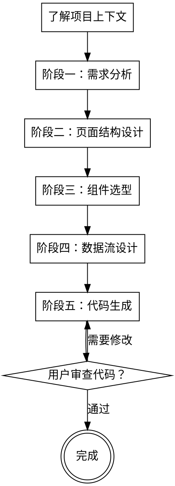

# BRD → 前端页面与组件生成

## 概述

一个严格的流程，将 BRD 文档和数据库设计转化为生产级的 Vue 3 前端页面和组件。使用 Ency Design 组件库，遵循 Vue 3 Composition API 和 TypeScript 最佳实践。

**核心原则：** 先理解需求，再设计页面结构，再选择组件，最后生成代码。绝不可跳过阶段。

## 何时使用

- 你有 `brd.md` 和 `db-schema.md`（或数据库设计文档），需要生成前端页面
- 你需要基于业务需求创建 CRUD 页面、表单、列表、详情页等
- 你需要使用 Ency Design 组件库快速构建企业级前端应用

## 技术栈

- **框架**: Vue 3.x (Composition API)
- **语言**: TypeScript
- **组件库**: Ency Design
- **状态管理**: Pinia (如需要)
- **路由**: Vue Router
- **HTTP 客户端**: Axios
- **构建工具**: Vite

## 检查清单

你必须为每个阶段创建任务并按顺序完成：

1. **了解项目上下文** — 读取 BRD + 数据库设计 + 现有前端代码结构
2. **阶段一：需求分析** — 提取功能需求、UI 需求、数据需求
3. **阶段二：页面结构设计** — 设计页面层次、路由结构、组件拆分
4. **阶段三：组件选型** — 从 Ency Design 选择合适的组件
5. **阶段四：数据流设计** — 设计 API 调用、状态管理、数据流转
6. **阶段五：代码生成** — 生成页面组件、路由配置、API 调用代码
7. **阶段六：用户审查** — 请用户审查生成的代码

## 流程



## 关键原则

- **一次一问** — 不要一次性抛出多个问题让用户不知所措
- **优先选择题** — 比开放式问题更容易回答
- **YAGNI 严格执行** — 从所有设计中剔除不必要的功能
- **组件复用优先** — 优先使用 Ency Design 现有组件，避免重复造轮子
- **增量验证** — 先呈现设计，获得批准后再推进
- **保持灵活** — 当某个地方说不通时，回去澄清
- **绝不跳过阶段** — 每个阶段必须完成才能进入下一个

---

## 阶段零：了解项目上下文

**开始前声明：** "我正在使用 front-ui skill。开始阶段零：了解项目上下文。"

### 步骤

1. **读取 `brd.md`** — 理解业务背景、功能需求、业务流程
2. **读取 `db-schema.md` 或数据库设计文档** — 理解数据结构、表关系
3. **检查现有前端代码结构**（如果项目已存在前端代码）：
   - 查看目录结构、现有页面、组件
   - 了解已有的路由配置、状态管理方案
   - 了解已有的 API 调用方式和封装
4. **评估范围** — 如果项目过大（涵盖多个独立模块），在开始任何设计前告知用户，建议拆分为多个子任务

---

## 阶段一：需求分析

**声明：** "开始阶段一：需求分析。"

### 步骤

1. **从 BRD 提取功能需求：**
   - 识别所有 F-* 功能需求
   - 将功能需求映射到前端页面（列表页、详情页、表单页等）
   - 识别 CRUD 操作需求

2. **从 BRD 提取 UI 需求：**
   - 识别页面布局要求
   - 识别交互方式（弹窗、抽屉、页面跳转等）
   - 识别特殊 UI 需求（图表、可视化、复杂表单等）

3. **从数据库设计提取数据需求：**
   - 识别核心业务实体
   - 识别实体关系（一对一、一对多、多对多）
   - 识别需要展示的字段和数据类型

4. **生成需求清单：**
   - 列出所有需要开发的页面
   - 列出每个页面的功能点
   - 列出数据交互需求

### 输出

将需求分析结果写入 `docs/frontend-requirements.md`

---

## 阶段二：页面结构设计

**声明：** "开始阶段二：页面结构设计。"

### 设计内容

1. **页面层次结构：**
   - 确定页面的层级关系（父页面、子页面）
   - 确定页面间的导航关系
   - 确定页面的布局方式（单栏、双栏、三栏等）

2. **路由结构设计：**
   - 设计路由路径和命名
   - 设计路由参数传递方式
   - 设计路由守卫和权限控制

3. **组件拆分策略：**
   - 识别可复用的业务组件
   - 识别页面级组件
   - 确定组件的职责边界

4. **页面设计示例：**

   对于典型的 CRUD 功能，设计如下页面结构：

   ```text
   /module-name
   ├── index.vue          # 列表页（查询、表格、分页）
   ├── detail.vue         # 详情页（只读展示）
   ├── form.vue           # 表单页（新增/编辑）
   └── components/        # 页面专用组件
       ├── SearchForm.vue # 搜索表单组件
       └── DataTable.vue  # 数据表格组件
   ```

### 页面结构设计输出

将页面结构设计写入 `docs/frontend-structure.md`

---

## 阶段三：组件选型

**声明：** "开始阶段三：组件选型。从 Ency Design 选择合适的组件。"

### 组件选型流程

1. **调用 Ency Design MCP 工具：**
   - 使用 `mcp__EncyDesignComponents__list-components` 获取可用组件列表
   - 根据需求搜索合适的组件

2. **常见页面的组件选型：**

   **列表页：**
   - `Table` - 数据表格
   - `Pagination` - 分页
   - `Button` - 操作按钮
   - `Input` / `Select` / `DatePicker` - 搜索表单
   - `Dialog` / `Drawer` - 弹窗/抽屉

   **表单页：**
   - `Form` - 表单容器
   - `FormItem` - 表单项
   - `Input` / `InputNumber` / `Select` / `DatePicker` / `Switch` - 表单控件
   - `Button` - 提交/取消按钮
   - `Upload` - 文件上传（如需要）

   **详情页：**
   - `Descriptions` - 描述列表
   - `Card` - 卡片容器
   - `Tabs` - 标签页（如有多个信息分组）

3. **获取组件文档和示例：**
   - 使用 `mcp__EncyDesignComponents__get-component-docs` 获取组件 API
   - 使用 `mcp__EncyDesignComponents__list-component-examples` 获取组件示例代码
   - 参考示例代码进行组件使用

4. **图标选择：**
   - 使用 `mcp__EncyDesignComponents__search-icons` 搜索合适的图标
   - 使用 `mcp__EncyDesignComponents__get-icon-usage` 获取图标使用示例

### 组件选型输出

将组件选型结果写入 `docs/component-selection.md`

---

## 阶段四：数据流设计

**声明：** "开始阶段四：数据流设计。"

### 设计内容

1. **API 接口设计：**
   - 根据后端 API 设计前端接口调用
   - 设计请求参数和响应数据的类型定义（TypeScript interface）
   - 设计 API 封装层（统一的请求/响应处理）

2. **状态管理设计：**
   - 评估是否需要全局状态管理（Pinia）
   - 简单页面使用组件内部状态（ref/reactive）
   - 复杂跨页面共享状态使用 Pinia store

3. **数据流转设计：**
   - 页面加载 → API 请求 → 数据渲染
   - 用户操作 → 表单验证 → API 提交 → 结果反馈
   - 列表操作 → 搜索/分页/排序 → API 请求 → 列表更新

4. **错误处理设计：**
   - API 错误统一处理（拦截器）
   - 表单验证错误提示
   - 加载状态和空状态处理

### 数据流设计输出

将数据流设计写入 `docs/data-flow-design.md`

---

## 阶段五：代码生成

**声明：** "开始阶段五：代码生成。"

### 代码生成规范

**文件结构：**

```text
src/
├── views/              # 页面组件
│   └── module-name/
│       ├── index.vue
│       ├── detail.vue
│       ├── form.vue
│       └── components/
├── api/                # API 接口
│   └── module-name.ts
├── types/              # TypeScript 类型定义
│   └── module-name.ts
├── stores/             # Pinia 状态管理（如需要）
│   └── module-name.ts
└── router/             # 路由配置
    └── modules/
        └── module-name.ts
```

**代码风格规范：**

1. **Vue 3 Composition API：**
   - 使用 `<script setup lang="ts">` 语法
   - 使用 `ref` / `reactive` 管理响应式数据
   - 使用 `computed` 定义计算属性
   - 使用 `watch` / `watchEffect` 监听数据变化

2. **TypeScript 类型定义：**
   - 所有 API 请求/响应定义 interface
   - 所有组件 props 定义类型
   - 使用泛型提高代码复用性

3. **组件命名规范：**
   - 页面组件使用 PascalCase（如 `UserList.vue`）
   - 业务组件使用 PascalCase（如 `SearchForm.vue`）
   - 组件文件名与组件名保持一致

4. **代码注释：**
   - 复杂逻辑添加注释说明
   - API 接口添加功能说明注释
   - 类型定义添加字段说明注释

### 生成步骤

1. **生成类型定义文件** (`types/module-name.ts`)
2. **生成 API 接口文件** (`api/module-name.ts`)
3. **生成页面组件** (`views/module-name/*.vue`)
4. **生成路由配置** (`router/modules/module-name.ts`)
5. **生成状态管理**（如需要）(`stores/module-name.ts`)

### 代码模板示例

**类型定义示例：**

```typescript
// types/user.ts
export interface User {
  id: number
  username: string
  email: string
  status: number
  createTime: string
}

export interface UserQuery {
  username?: string
  status?: number
  pageNum: number
  pageSize: number
}

export interface UserForm {
  username: string
  email: string
  password?: string
}
```

**API 接口示例：**

```typescript
// api/user.ts
import request from '@/utils/request'
import type { User, UserQuery, UserForm } from '@/types/user'

export const getUserList = (params: UserQuery) => {
  return request.post<{ list: User[]; total: number }>('/api/user/list', params)
}

export const getUserDetail = (id: number) => {
  return request.get<User>(`/api/user/${id}`)
}

export const createUser = (data: UserForm) => {
  return request.post('/api/user/create', data)
}

export const updateUser = (id: number, data: UserForm) => {
  return request.post(`/api/user/update/${id}`, data)
}

export const deleteUser = (id: number) => {
  return request.post(`/api/user/delete/${id}`)
}
```

**路由配置示例：**

```typescript
// router/modules/user.ts
import type { RouteRecordRaw } from 'vue-router'

const userRoutes: RouteRecordRaw[] = [
  {
    path: '/user',
    name: 'User',
    redirect: '/user/list',
    children: [
      {
        path: 'list',
        name: 'UserList',
        component: () => import('@/views/user/index.vue'),
        meta: { title: '用户列表' }
      },
      {
        path: 'detail/:id',
        name: 'UserDetail',
        component: () => import('@/views/user/detail.vue'),
        meta: { title: '用户详情' }
      },
      {
        path: 'form/:id?',
        name: 'UserForm',
        component: () => import('@/views/user/form.vue'),
        meta: { title: '用户表单' }
      }
    ]
  }
]

export default userRoutes
```

---

## 阶段六：用户审查

**声明：** "代码生成完成。请审查生成的代码。"

### 审查清单

1. **代码完整性：**
   - 所有必需的文件都已生成
   - 类型定义完整
   - API 接口完整
   - 页面组件完整

2. **代码质量：**
   - 代码风格统一
   - 类型定义准确
   - 组件使用正确
   - 错误处理完善

3. **功能完整性：**
   - 所有 BRD 需求都已实现
   - 页面交互符合预期
   - 数据流转正确

4. **用户体验：**
   - 页面布局合理
   - 交互流畅
   - 错误提示友好

### 用户反馈处理

- 如果用户要求修改，根据反馈调整代码
- 如果用户批准，提交代码到 git

---

## 常见错误

| 错误 | 修复 |
|------|------|
| 未使用 Ency Design 组件 | 优先使用 Ency Design 组件库，避免自己实现 |
| 类型定义不完整 | 所有 API 请求/响应都要定义 TypeScript interface |
| 未使用 Composition API | 使用 `<script setup>` 语法，不使用 Options API |
| 组件职责不清 | 明确组件边界，避免组件过大或职责混乱 |
| 缺少错误处理 | 所有 API 调用都要有 try-catch 和错误提示 |
| 缺少加载状态 | 异步操作要显示 loading 状态 |
| 未使用路由参数 | 详情页、编辑页要通过路由参数传递 ID |
| 表单验证缺失 | 表单提交前要进行验证 |

## 质量关卡

阶段之间切换前验证：

- **阶段零→一：** BRD 和数据库设计已读取理解
- **阶段一→二：** 功能需求、UI 需求、数据需求已提取
- **阶段二→三：** 页面结构、路由结构、组件拆分已设计
- **阶段三→四：** 组件选型完成，组件文档已查阅
- **阶段四→五：** 数据流、API 接口、状态管理已设计
- **阶段五→六：** 代码已生成，文件结构完整
- **阶段六→完成：** 用户已审查并批准代码

---

## Ency Design 组件使用指南

### 常用组件清单

**数据展示：**

- `Table` - 数据表格
- `Descriptions` - 描述列表
- `Card` - 卡片
- `Tag` - 标签
- `Badge` - 徽章

**数据录入：**

- `Form` / `FormItem` - 表单
- `Input` - 输入框
- `InputNumber` - 数字输入框
- `Select` - 选择器
- `DatePicker` - 日期选择器
- `TimePicker` - 时间选择器
- `Switch` - 开关
- `Checkbox` - 多选框
- `Radio` - 单选框
- `Upload` - 文件上传

**反馈：**

- `Message` - 消息提示
- `MessageBox` - 消息弹窗
- `Loading` - 加载
- `Dialog` - 对话框
- `Drawer` - 抽屉

**导航：**

- `Menu` - 菜单
- `Tabs` - 标签页
- `Breadcrumb` - 面包屑
- `Pagination` - 分页

**布局：**

- `Layout` - 布局容器
- `Container` - 容器
- `Row` / `Col` - 栅格布局

### 组件使用最佳实践

1. **查阅组件文档：**

   ```typescript
   // 使用 MCP 工具获取组件文档
   mcp__EncyDesignComponents__get-component-docs({ componentName: 'Table' })
   ```

2. **参考组件示例：**

   ```typescript
   // 使用 MCP 工具获取组件示例
   mcp__EncyDesignComponents__list-component-examples({ componentName: 'Table' })
   ```

3. **搜索合适的图标：**

   ```typescript
   // 使用 MCP 工具搜索图标
   mcp__EncyDesignComponents__search-icons({ keyword: '编辑' })
   ```

---

## 参考文档

执行各阶段时按需读取以下参考文档：

| 参考文档 | 何时使用 |
| --- | --- |
| Ency Design 官方文档 | 组件选型和使用时 |
| Vue 3 官方文档 | Composition API 使用时 |
| TypeScript 官方文档 | 类型定义时 |
| 项目前端规范文档 | 代码生成时（如果存在） |

---

## 开始使用

当用户提出前端页面开发需求时，首先执行以下步骤：

1. **声明使用 skill：** "我正在使用 front-ui skill 来生成前端页面。"
2. **检查必需文件：**
   - 检查 `brd.md` 是否存在
   - 检查 `db-schema.md` 或数据库设计文档是否存在
   - 如果缺失，询问用户文件位置或请求提供
3. **开始阶段零：** 了解项目上下文
4. **按流程逐步推进：** 严格按照阶段顺序执行，不跳过任何阶段

**关键要求：每个阶段完成后，向用户展示当前阶段的产出，获得确认后再进入下一阶段。**
