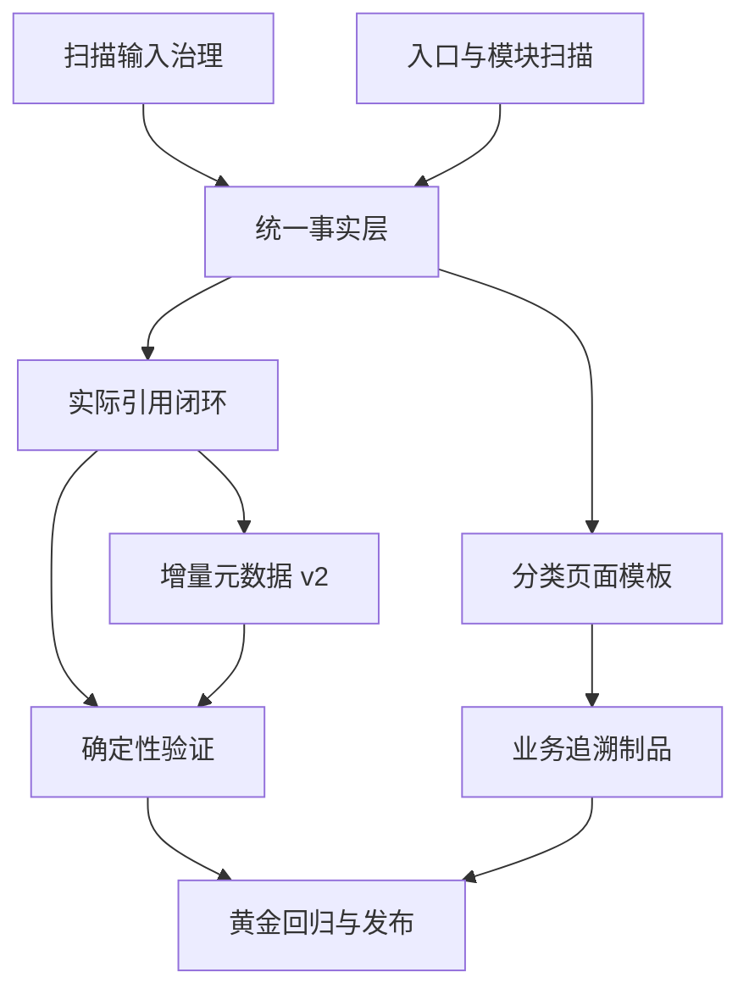

# repo-wiki Skill 优化提升方案

> 状态：待实施  
> 编制日期：2026-08-07  
> 优化对象：`skills/repo-wiki/`  
> 分析样本：一个企业级 Java 多模块仓库中的三套 Wiki 生成结果  
> 样本定位：仅用于发现通用问题和比较生成效果，不属于 Skill 定制范围  
> 方案用途：作为后续 `repo-wiki` Skill 优化、任务拆分、回归测试和验收依据

## 1. 方案结论

本轮优化不应以“生成更多页面、更多 Mermaid 图、更多源码引用”为首要目标，而应先解决三类基础问题：

1. **输入不干净**：扫描会把历史 Wiki、备份目录等生成物再次当作源码输入，且可能漏掉符号链接目录中的需求文档。
2. **事实不稳定**：模块依赖、接口类型、部署形态、业务规则等关键结论过度依赖 LLM 临场推断，缺少统一、可验证的事实层。
3. **验证不充分**：现有验证偏 Markdown 格式检查，不能证明源码引用有效、跨页结论一致、业务描述可追溯，也不能保证增量生成真的感知了所有变化。

因此建议采用以下总体策略：

> **先可信，后完整；先可验证，后扩规模；以业务能力和实现证据组织内容，而不是以页数组织内容。**

目标生成链路调整为：


## 2. 与现有升级方案的关系

项目内已有 [2026-08-06-repo-wiki-升级方案.md](./2026-08-06-repo-wiki-升级方案.md)，其主要目标是对标 Qoder，扩大页面数量、目录深度和图表数量。本方案不覆盖该文档，而是补充其尚未解决的质量基础，并调整实施优先级。

两份方案的关系如下：

| 方案 | 主要关注点 | 建议定位 |
| --- | --- | --- |
| 2026-08-06 升级方案 | 覆盖广度、模块卡、深度模式、导航层级 | 作为 P1/P2 的内容扩展参考 |
| 本方案 | 输入治理、事实建模、业务追溯、引用闭环、增量正确性、验证与测试 | 作为近期优化的主实施基线 |

以下指标不再建议作为硬性验收目标：

- 正文必须达到 90—130 页；
- Mermaid 必须达到 500 张；
- 每页必须引用至少 5 个源文件；
- 每个模块固定生成 5 张同构页面。

这些指标容易诱发拆页、重复内容和无效图表。应改为按仓库规模、页面类型、业务复杂度动态确定，并以事实覆盖率、业务追溯率、引用有效率和跨页一致性作为核心指标。

## 3. 对比样本与分析基线

### 3.1 三套文档的总体判断

本方案的前置分析在同一个企业级 Java 多模块仓库中对比了三套 Wiki。该仓库只是观察样本，下面的数据用于解释问题如何被发现，不会转化为项目名称、模块名称或技术栈的硬编码：

- `.qoder/repowiki/`：覆盖最广、目录最细，但生成内容、知识卡和正文混杂，重复及噪声较多；
- `zcode-wiki/`：模块组织较清晰，但技术事实、源码证据和业务细节不如 `docs/wiki/`；
- `docs/wiki/`：由 `repo-wiki` Skill 生成，在架构准确性、业务链路、源码引用和可维护性方面总体最好，最适合作为后续需求开发的基础版本。

本次快照中的 Markdown 文件数量为：

| 文档集 | Markdown 文件数 | 说明 |
| --- | ---: | --- |
| `.qoder/repowiki/` | 285 | 包含正文、知识卡和辅助文件，不能直接等同于有效页面数 |
| `docs/wiki/` | 17 | 单页信息密度高，架构与业务结合较好 |
| `zcode-wiki/` | 28 | 粒度介于两者之间 |

综合评分基线为：`docs/wiki` 91、`zcode-wiki` 73、Qoder 71。评分仅用于说明当前相对水平，不作为 Skill 优化后的自动验收分数。

### 3.2 样本中 `docs/wiki` 的主要优势

- 能正确区分 Spring Boot 多模块**单体服务**与可独立部署的微服务集合；
- 能从构建配置和启动类中识别唯一部署物；
- 能把 Controller、Service、Manager、DAO、Facade 与业务流程关联起来；
- 能描述二级商入驻、费用结算、政策、订单、风控等核心业务链路；
- 源码引用使用相对路径，当前抽检的引用目标可定位；
- 已有 `meta.yaml` 和源码哈希，具备向增量 Wiki 演进的基础。

### 3.3 当前不能忽略的局限

- 页面平均体量偏大，架构、机制、业务规则和接口细节常集中在同一页；
- 行号引用只是生成时快照，不是稳定锚点，代码改动后容易失效；
- 对“当前实现”“仓库规则”“规划目标”“推断结论”没有显式分类；
- 业务文档接近“基于代码反推的现状说明”，还不能替代正式 BRD；
- 业务规则、状态流转、异常分支、验收条件缺少结构化索引；
- 跨页面对同一事实的表述没有自动一致性检查。

## 4. 已确认的问题清单

### 4.1 P0：影响正确性的问题

| 编号 | 问题 | 已观察到的证据 | 影响 |
| --- | --- | --- | --- |
| P0-01 | 扫描输入被生成物污染 | Git 跟踪文件约 991 个，扫描结果为 1371 个；额外文件主要来自 `.qoder/repowiki`、`zcode-wiki`、`docs-bak` 和 `.repo-wiki` | LLM 可能引用旧 Wiki 结论，形成“文档生成文档”的回音污染 |
| P0-02 | 符号链接策略缺失 | 对比样本中的文档目录是 Windows 符号链接，默认 `os.walk(..., followlinks=False)` 不进入该目录 | 任意仓库通过符号链接维护的需求或设计文档都可能被漏扫 |
| P0-03 | API 扫描误报和分类混淆 | Java `Map.put(...)` 被识别为 Gin 路由；注释中的注解示例被识别为接口；Feign 出站调用与入站接口混在一起 | API 数量、边界和业务入口不可信 |
| P0-04 | 模块依赖没有真正产出 | `scan_modules.py` 能识别 Maven 模块，但 `depends_on` 仍为空 | 架构图和影响分析继续依赖 LLM 推断 |
| P0-05 | 元数据仓库路径为空 | `export_wiki.py` 读取 `scan_data.repo_path`，但 `scan_repo.py` 未输出该字段 | `meta.yaml` 缺少必要溯源信息 |
| P0-06 | 实际引用没有回流 | 页面可使用结构规划之外的源码，但这些文件不会回写结构和元数据 | 增量哈希可能漏掉真实依赖，页面不会及时重生成 |
| P0-07 | 完成态仍可被当作断点 | 完成生成后 `.wiki-state.yaml` 仍保留，状态规范对保留和清理表述不一致 | 下一次运行可能从陈旧完成态恢复 |
| P0-08 | 验证只证明“格式像 Wiki” | 未验证引用文件、行号、符号、标题映射、孤儿页、陈旧页和跨页事实 | 验证通过不等于内容可作为开发依据 |

### 4.2 P1：影响业务可用性的问题

| 编号 | 问题 | 影响 |
| --- | --- | --- |
| P1-01 | 缺少统一业务能力目录 | 新需求难以判断应落在哪个业务域、模块和既有流程 |
| P1-02 | 缺少结构化状态机与规则索引 | 需求分析无法快速识别状态、前置条件、异常和幂等约束 |
| P1-03 | 页面模板单一 | 架构页、API 页、业务流程页和运维页使用同一写法，信息重点失衡 |
| P1-04 | 所有页面被要求大量使用图表和至少 5 个源文件 | 容易为了满足形式要求生成无信息增益的图表和引用 |
| P1-05 | 页面并行生成缺少共享事实 | 不同页面可能对模块职责、部署形态、业务术语产生冲突描述 |
| P1-06 | 全面模式与深度模式跨度过大 | 8—25 页之后直接跳到 80—150 页，缺少适合企业单体项目的中间档 |

### 4.3 P2：影响长期维护的问题

- 缺少手工补充内容的保护和合并机制；
- 增量哈希没有覆盖提示词版本、Skill 版本、事实模型版本和结构版本；
- 源文件内容哈希未显式包含路径，重命名场景识别不充分；
- 缺少固定样例仓库、黄金结果和持续集成回归；
- Mermaid 只检查代码块存在，未通过真实解析器验证语法；
- 引用依赖行号，缺少“文件 + 稳定符号”的引用方式。

## 5. 优化目标与边界

### 5.1 核心目标

1. 生成内容中的关键事实都能追溯到源码、可执行配置、仓库规则或明确标注的推断。
2. 架构、模块、接口、数据、消息、任务和业务能力共享同一事实层。
3. Wiki 可用于新需求的现状分析、影响分析和设计输入，但不把反推文档冒充正式需求。
4. 增量更新能够准确识别源码、结构、提示词和事实变化。
5. 验证失败能给出完整问题清单，阻止不可信产物被发布。
6. 通过多语言、多构建体系的合成样例和通用黄金断言支持持续回归。

### 5.2 非目标

- 不在本阶段建设完整文档站点 UI；
- 不直接生成新的业务需求或替代 `ontology-modeling`、`app-design` 等下游 Skill；
- 不要求所有仓库生成相同目录、相同页数或相同图表数量；
- 不强制引入第三方依赖，标准库可以完成的能力仍优先使用标准库；
- 不在生成 Wiki 时修改被分析仓库的业务代码或配置。

### 5.3 通用化设计原则

1. **核心与适配器分离**：扫描编排、事实 schema、结构规划、页面生成和验证属于通用核心；Java/Spring、Node、Python、Go 等识别能力通过适配器注册。
2. **禁止仓库特判**：代码、提示词和默认配置中不得出现对比样本的仓库名、模块名、包名前缀、业务术语或路径分支，也不得根据仓库名选择行为。
3. **规则作为输入**：`AGENTS.md`、仓库规则、构建约束和业务术语都作为当前仓库的数据读取，不能上升为所有仓库的默认规则。
4. **能力探测而非技术栈假设**：先检测构建文件、语言、框架和入口，再启用对应适配器；未知技术栈应降级为通用文件与符号扫描。
5. **配置驱动**：排除目录、符号链接根、页面模式、事实来源优先级和增强验证均允许通过仓库级配置覆盖。
6. **测试样本独立**：黄金断言放在 fixture 数据中，不进入生产代码；真实项目只做匿名化 smoke test，不作为发布的唯一门槛。
7. **可解释降级**：适配器不支持某类事实时，应记录 `unsupported` 或低置信度推断，不能编造确定性结论。

## 6. 目标设计

### 6.1 确定性事实层

新增中间产物 `.repo-wiki/wiki_facts.json`，统一承载后续目录生成、页面生成和验证所需的事实。建议至少包含：

```json
{
  "schema_version": 1,
  "repository": {
    "path": "...",
    "branch": "feature/introducer",
    "git_commit": "<git-sha>",
    "dirty": false
  },
  "build": {},
  "runtime": {},
  "modules": [],
  "inbound_endpoints": [],
  "outbound_clients": [],
  "messages": [],
  "scheduled_jobs": [],
  "data_objects": [],
  "business_capabilities": [],
  "repository_rules": [],
  "assertions": []
}
```

事实必须携带类型和证据：

| 类型 | 含义 | 示例 |
| --- | --- | --- |
| `observed` | 来自源码或可执行配置的当前事实 | 某 server 模块生成 fat jar |
| `repository_rule` | 来自 `AGENTS.md`、`.ai/rules` 等仓库约束 | 跨模块调用必须通过 facade |
| `planned` | 设计文档中计划但源码尚未实现 | 规划中的服务拆分 |
| `inferred` | 根据多个信号推导，必须显示置信度和依据 | 某类组合构成一个业务子域 |
| `recommendation` | Wiki 给出的建议，不代表现状 | 建议增加幂等键 |

事实来源优先级固定为：

```text
可执行配置/源码 > AGENTS.md/仓库规则 > 维护中的设计文档 > README > 明确标注的推断
```

当多个来源冲突时，不允许静默选择；事实层应记录冲突并要求页面明确说明。

### 6.2 页面类型模型

将通用页面模板拆为按页面类型裁剪的模板：

| 页面类型 | 必须回答的问题 | 建议图表 |
| --- | --- | --- |
| 架构页 | 部署单元、模块边界、依赖方向、调用链、技术约束 | 架构图、依赖图 |
| 业务流程页 | 参与者、触发条件、主流程、状态变化、规则、异常、结果 | 流程图、状态图、时序图 |
| API 页 | 入站/出站、协议、权限、请求响应、错误、幂等、调用方 | 时序图可选 |
| 数据页 | 数据所有权、表/实体关系、生命周期、逻辑删除、索引 | ER 图可选 |
| 集成页 | 外部系统、方向、协议、重试、超时、降级、一致性 | 集成时序图 |
| 实现机制页 | 关键类、扩展点、事务、并发、缓存、批处理 | 类图或时序图可选 |
| 运维页 | 配置、部署、监控、告警、排障、恢复 | 部署图可选 |

图表、表格和源码数量按页面类型动态要求。没有信息增益时允许不生成图表，不再使用“每页至少 5 个源文件”和“大量使用 Mermaid”作为通用约束。

### 6.3 面向新需求的业务视图

Wiki 仍然定位为“当前系统事实百科”，但必须增加适合下游需求分析使用的派生视图：

- 业务能力目录：业务域、能力、责任模块、入口、核心对象；
- 业务流程目录：参与者、触发器、前置条件、主流程、异常分支、输出；
- 状态机索引：对象、状态、允许迁移、触发动作、校验规则；
- 业务规则索引：规则、适用范围、实现位置、配置位置、例外；
- 数据责任目录：主数据、数据所有者、读写模块、同步方式；
- 外部依赖目录：系统、协议、方向、失败策略、补偿方式；
- 非功能约束：事务、并发、幂等、性能、权限、审计和数据安全；
- 追溯矩阵：业务能力 → 接口/消息/任务 → Service/Manager → 表/外部系统。

这些视图应明确标注“从当前实现反推”，正式新需求仍需由需求建模流程补充目标状态、验收条件和变更决策。

## 7. 实施任务

### 7.1 P0-1：治理扫描输入

**涉及文件**：`scripts/scan_repo.py`、`SKILL.md`

实施内容：

1. 默认优先使用 `git ls-files` 构建源码清单；非 Git 仓库再回退到目录遍历。
2. 默认排除 Wiki 输出、缓存、备份和 Skill 临时目录：
   - `.qoder/repowiki/`
   - `docs/wiki/`
   - `zcode-wiki/`
   - `docs-bak/`
   - `.repo-wiki/`
   - 常见构建目录和 IDE 缓存
3. 增加 `--include`、`--exclude` 与配置文件覆盖机制。
4. 增加符号链接策略：`skip`、`internal-only`、`follow`，默认使用 `internal-only`，并进行循环检测。
5. 对 `.env`、密钥、证书、私钥和凭据文件做默认排除及告警。
6. 输出 `repo_path`、Git 分支、提交、dirty 状态、扫描模式、排除原因和扫描统计。
7. 根 README、构建文件和规则文件使用确定性优先级，不依赖目录遍历顺序。

验收标准：

- 任意 fixture 中的 Wiki 输出和备份目录都不会再次成为源码输入；
- 能按配置读取符号链接中的文档目录，且不会扫描到允许根目录之外；
- 扫描结果记录每个被排除目录的规则和数量；
- 敏感文件内容不会进入任何提示词、中间产物或日志。

### 7.2 P0-2：修正接口与模块扫描

**涉及文件**：`scripts/scan_api_entries.py`、`scripts/scan_modules.py`

实施内容：

1. 按文件语言分派扫描器，不再对所有文件套用全部框架正则。
2. 在识别注解或路由前剥离注释、字符串示例和明显的文档片段。
3. Spring 路由合并类级与方法级路径，支持 `value`、`path`、`method` 组合。
4. 输出类型拆分为：
   - `inbound_http`
   - `outbound_http_client`
   - `message_consumer`
   - `message_producer`
   - `scheduled_job`
   - `event_listener`
5. Feign Client 单独归入出站依赖，不计入对外提供 API 数量。
6. 即使存在 HTTP 接口，也继续扫描 MQ、事件和定时任务，不再使用“HTTP 为零才回退”的策略。
7. 从 Maven `<dependency>`、模块间 artifactId 引用和跨模块 import 中计算 `depends_on`，并记录推导证据。
8. 模块补充 `type`、`runtime_role`、`is_deployable`、`is_placeholder`、启动类、源码/测试数量等属性。

验收标准：

- Java fixture 中的 `Map.put(...)` 不再被识别为 Gin 路由；
- 注释中的注解示例不再计入接口；
- 入站接口与 Feign/Client 出站能力分开统计；
- Maven、Gradle、Node workspace、Python package 和 Go module 等受支持 fixture 能输出模块及实际依赖；
- 能基于构建产物、启动入口和部署配置识别可部署模块，不把占位模块描述为独立运行服务。

### 7.3 P0-3：生成统一事实层

**新增/涉及文件**：建议新增 `scripts/build_facts.py`、`references/facts-schema.md`，调整 `SKILL.md`

实施内容：

1. 合并仓库扫描、构建扫描、模块扫描、接口扫描、规则文件和需求文档摘要。
2. 每条事实记录 `id`、`type`、`value`、`evidence`、`confidence` 和 `conflicts`。
3. 提供稳定 ID，支持增量比较和验证引用。
4. 结构生成只消费事实层和经过筛选的文件树，不直接在多个原始扫描结果之间自由推断。
5. 页面生成必须引用事实 ID；新增推断应回写为 `inferred`，不能伪装为 observed。

验收标准：

- “多模块单体”“唯一部署物”“模块依赖”“入站/出站接口”等结论只定义一次；
- 任一关键事实可定位到至少一条仓库证据；
- 冲突事实会让验证失败或以醒目标记进入待确认清单。

### 7.4 P0-4：闭环记录页面实际依赖

**涉及文件**：`references/agent-contracts.yaml`、`scripts/export_wiki.py`、`references/meta-yaml-format.md`

每个页面生成时同时输出 sidecar，例如：

```json
{
  "page_id": "example-business-flow",
  "facts": ["fact.module.example", "fact.rule.example"],
  "used_sources": [
    {
      "path": "modules/example/src/.../ExampleService.ext",
      "symbol": "ExampleService#updateStatus",
      "lines": [120, 168]
    }
  ]
}
```

实施内容：

1. 生成器返回 Markdown 和 `used_sources.json`，两者必须同时成功。
2. `export_wiki.py` 根据实际引用而非仅根据结构规划计算页面依赖。
3. 引用首选“文件 + 类/方法/配置键”等稳定符号，行号作为辅助信息。
4. `meta.yaml` 聚合实际引用、事实 ID、页面哈希与来源哈希。

验收标准：

- 页面中出现的所有源码引用都能在 sidecar 和 `meta.yaml` 中找到；
- 修改实际引用但未在原结构 `filePaths` 中声明的源码时，页面会进入待更新集合；
- 源文件重命名能被识别，不因内容相同而错误复用旧页面。

### 7.5 P0-5：重构增量元数据

**涉及文件**：`scripts/export_wiki.py`、`references/meta-yaml-format.md`

`meta.yaml` 建议增加：

```yaml
schema_version: 2
repository:
  path: "..."
  branch: feature/introducer
  git_commit: "<git-sha>"
  dirty: false
generator:
  skill_version: "..."
  prompt_hash: "..."
  facts_hash: "..."
  structure_hash: "..."
pages:
  - id: example-business-flow
    content_hash: "..."
    source_hash: "..."
    actual_used_sources: []
    manual_edit_hash: "..."
```

哈希输入至少包含：规范化路径、文件内容、事实、结构、页面模板、提示词和 Skill 版本。缺失源文件不得静默忽略。

验收标准：

- 只改提示词、事实生成器或结构时，受影响页面会重新生成；
- 删除、增加、移动源文件均可正确判断影响范围；
- 工作区有未提交修改时，元数据能明确记录，不能只写 HEAD 提交；
- 目录移除页面后，旧页面能通过发布清单识别为 stale，而不是继续残留。

### 7.6 P0-6：强化确定性验证

**涉及文件**：`scripts/verify_wiki.py`、`references/verify-checklist.md`

硬门禁至少包括：

1. 结构 ID、页面 ID、标题和输出路径唯一；
2. H1 与结构标题一致；
3. `relatedPages`、父节点和事实 ID 均存在；
4. 源码相对路径存在且不得越出仓库；
5. 行号范围有效，符号能在目标文件中定位；
6. 页面引用与 sidecar、`meta.yaml` 一致；
7. 内部 Markdown 链接、锚点和图片存在；
8. 全目录递归检查非法文件名和大小写冲突；
9. 不存在孤儿页、陈旧页和未登记页面；
10. 必须满足事实断言，且不能出现已知互斥结论；
11. 敏感路径和密钥模式不得出现在产物中；
12. 所有错误聚合输出，单次验证列出完整整改清单。

建议保留的软门禁：

- 页面过长或过短；
- 缺少适合该页面类型的图表或表格；
- 业务流程缺少异常分支；
- 关键模块覆盖不足；
- 推断事实比例过高；
- 页面之间存在近似重复段落。

验收标准：

- 人为制造错误路径、越界行号、重复标题、陈旧页面和不一致元数据时，验证都能失败；
- 一次验证报告显示全部问题，而不是遇到第一个错误即退出；
- 当前仓库适用的通用事实断言失败时禁止发布 Wiki。

### 7.7 P0-7：修正运行状态生命周期

**涉及文件**：`references/state-ledger.md`、`references/wiki-state.example.yaml`、`SKILL.md`

状态文件增加：

```yaml
run_id: "..."
run_status: running  # running | failed | completed
started_at: "..."
completed_at: null
repository_fingerprint: "..."
```

规则：

- 只有 `running` 或 `failed` 且仓库指纹兼容的状态可以恢复；
- `completed` 状态在发布成功后归档或删除，不作为下一次默认断点；
- 恢复前检查 Skill 版本、事实 schema 和结构 schema；
- 状态格式变化时明确执行迁移或重新开始，不能带病恢复。

### 7.8 P0-8：建立自动化测试与黄金回归

**建议新增目录**：`skills/repo-wiki/tests/`

最小样例集：

| 样例 | 覆盖场景 |
| --- | --- |
| `maven-multimodule` | 模块、依赖、唯一启动模块、占位模块 |
| `spring-and-feign` | 入站 Controller 与出站 Feign 分类 |
| `comment-false-positive` | 注释、Javadoc 和字符串中的伪注解 |
| `mixed-entrypoints` | HTTP、MQ、事件、Job 同时存在 |
| `broken-references` | 不存在路径、越界行号、缺失符号 |
| `incremental-changes` | 新增、删除、重命名、内容变化、提示词变化 |
| `state-resume` | 失败恢复、完成态清理、schema 不兼容 |
| `symlink-and-secrets` | 符号链接边界、循环和敏感文件排除 |
| `manual-edits` | 后续人工内容保护 |

通用黄金断言至少包括：

- Maven fixture 能识别声明的子模块、聚合关系和模块依赖；
- 单体 fixture 能从唯一启动入口和打包配置识别唯一部署物；
- 多模块不被自动等同于微服务，部署形态必须有运行和构建证据；
- 占位模块不得被描述为已运行的业务服务；
- Node workspace、Python package 和 Go module fixture 能启用对应适配器，不受 Java 规则干扰；
- fixture 中声明的跨模块访问规则被归类为 `repository_rule`，但不会传播到其他仓库；
- 代码规范只表示仓库要求，不能根据规则文件推断全部实现已经遵守；
- 生产代码和默认提示词中不存在任何测试仓库、真实项目或业务模块名称。

## 8. P1：提升内容结构和业务分析能力

### 8.1 增加“业务域模式”

在全面模式与 80—150 页深度模式之间增加“业务域模式”，建议范围为 20—40 页。该模式适用于具有多个业务域、但共享一个或少量部署单元的企业应用：

- 按业务能力划分主页面；
- 为公共能力、集成、数据、运维和开发约束保留独立页面；
- 复杂业务域可拆流程、状态机、规则和数据页面；
- 简单或占位模块不强制生成五页模块卡。

模式选择依据应来自模块数、入口数、核心对象数、业务能力数和源码规模，而不是仅判断是否为多模块仓库。

### 8.2 建立共享术语表和规范事实

在页面并行生成前生成：

- `glossary.yaml`：统一业务术语、别名和禁止混用的词；
- `canonical-facts.yaml`：部署形态、模块职责、关键状态和系统边界；
- `naming-map.yaml`：代码名称与中文业务名称的映射。

页面生成器必须读取这些文件。生成完成后增加跨页一致性审计，重点检查：

- 同一模块是否出现多个职责描述；
- 同一状态是否存在不同中文名称；
- 同一接口是否同时被描述为入站和出站；
- 同一项目是否同时出现“单体”和“微服务”结论；
- 业务流程步骤与状态迁移是否互相矛盾。

### 8.3 输出业务追溯制品

除 Markdown 外，建议输出机器可读制品：

- `capabilities.yaml`
- `business-rules.yaml`
- `state-machines.yaml`
- `traceability.yaml`

后续 `ontology-modeling`、`app-design` 或人工需求分析可读取这些文件，避免再次从自然语言 Wiki 中抽取结构化信息。

## 9. P2：长期维护能力

### 9.1 手工内容保护

提供至少一种明确机制：

1. 生成区与人工区标记；或
2. 页面 overlay 文件；或
3. 覆盖前自动生成差异和备份并等待确认。

检测到未登记的人工修改时，默认不能整页覆盖。人工内容的处理结果需写入 `meta.yaml`。

### 9.2 Mermaid 真实验证

基础验证仍保持无外部依赖；在环境允许时提供增强验证，通过 Mermaid CLI 或等价解析器验证语法，并把渲染失败页面加入报告。该能力应为可选增强，不阻塞纯 Python 环境运行。

### 9.3 可选代码图谱接入

为 Codebase Memory、语言服务器或静态分析器预留适配接口，用于补充：

- 真实调用链；
- 符号级引用；
- 跨模块依赖；
- 数据表与 Mapper 关系；
- 改动影响范围。

外部工具不可用时必须回退到本地扫描，不应让 Skill 失去独立可用性。

## 10. 建议实施路线

| 迭代 | 范围 | 主要交付物 | 退出条件 |
| --- | --- | --- | --- |
| 迭代 1：扫描可信 | P0-1、P0-2、测试骨架 | 干净文件清单、入口分类、模块依赖、基础 fixtures | 各语言 fixture 的扫描噪声和已知误报清零 |
| 迭代 2：事实与溯源 | P0-3、P0-4、P0-5 | `wiki_facts.json`、used_sources、meta v2 | 关键事实和页面依赖可追溯，增量用例通过 |
| 迭代 3：质量门禁 | P0-6、P0-7、通用黄金断言 | 聚合验证报告、状态生命周期、golden tests | 故障注入测试全部被门禁拦截 |
| 迭代 4：业务可用 | P1 页面模板、业务域模式、结构化业务索引 | 分类模板、20—40 页模式、traceability 制品 | 可从 Wiki 定位业务能力、规则、状态和实现证据 |
| 后续增强 | P2 | 人工合并、Mermaid 增强、代码图谱适配 | 按实际使用反馈立项 |

实施依赖关系：



## 11. 验收指标

### 11.1 正确性指标

- 源码引用路径有效率：100%；
- 引用符号可定位率：100%；
- 页面引用与 sidecar/meta 一致率：100%；
- 已知关键架构事实断言通过率：100%；
- 入站、出站、消息和任务入口分类的人工抽检准确率：不低于 98%；
- 生成物、备份和敏感文件进入扫描输入的数量：0。

### 11.2 业务可用性指标

- 核心业务能力均可定位责任模块和实现入口；
- 核心状态流转均包含触发条件、允许迁移和异常处理；
- 关键业务规则均可追溯到源码、配置或仓库规则；
- 新需求分析可从能力目录进入，并沿追溯矩阵定位到接口、服务、数据和外部依赖；
- “当前事实、仓库规则、计划、推断、建议”在页面中可区分。

### 11.3 工程指标

- 所有脚本具备自动化测试；
- 增量新增、删除、重命名、提示词变化和事实变化用例全部通过；
- 完成态不会被误恢复；
- 验证报告可一次列出全部问题；
- 同一提交、同一 Skill 版本和同一配置下生成结构可重复。

## 12. 完成定义（Definition of Done）

本方案的 P0 阶段只有同时满足以下条件才算完成：

- [ ] 扫描输入不包含任何已知 Wiki 输出和备份目录；
- [ ] 符号链接、安全边界和敏感文件策略有测试覆盖；
- [ ] API、Feign、MQ、事件和 Job 能独立分类；
- [ ] Maven 模块依赖不再为空占位；
- [ ] `wiki_facts.json` schema 已固定并有版本号；
- [ ] 页面实际引用已回写 sidecar 和 meta；
- [ ] 增量哈希覆盖路径、内容、事实、结构、提示词和 Skill 版本；
- [ ] 硬门禁能够拦截路径、行号、符号、标题、孤儿页、陈旧页和事实冲突；
- [ ] 状态文件只恢复未完成且兼容的运行；
- [ ] 多语言 fixtures 和通用黄金断言进入自动回归；
- [ ] 使用升级后的 Skill 在至少三类代表性仓库上重新生成 Wiki，并完成匿名化人工抽检；
- [ ] 生产代码、提示词和默认配置中不存在任何对比样本名称或仓库特判；
- [ ] 新旧 meta/schema 的兼容或迁移策略已写入发布说明。

## 13. 风险与控制

| 风险 | 控制措施 |
| --- | --- |
| 当前 `repo-wiki` 已有未提交改动，任务可能重叠 | 实施前先盘点 Git diff，把本方案任务映射到已完成、部分完成、未开始三种状态，禁止直接覆盖 |
| 事实层 schema 一次设计过大 | 首版只覆盖仓库、构建、模块、入口、规则和断言，按版本兼容方式扩展 |
| 业务能力仍需 LLM 归纳 | 标记为 inferred，保留证据和置信度，并允许人工确认后提升为维护事实 |
| 强门禁导致旧 Wiki 无法通过 | 提供迁移报告和一次性修复模式，不降低新版本门禁标准 |
| Git 文件清单会漏掉未跟踪但有价值的设计文档 | 默认纳入明确白名单的未跟踪文档，并在扫描报告中单列，不静默混入 |
| 符号链接可能越出仓库边界 | 使用显式允许根目录列表、真实路径校验和循环检测 |
| 页面类型增加后提示词维护成本上升 | 抽取共用规则，模板只保留类型差异；对提示词也做版本与回归测试 |

## 14. 建议改动文件映射

| 文件 | 主要调整 |
| --- | --- |
| `skills/repo-wiki/SKILL.md` | 新流程、事实层、业务域模式、状态和发布规则 |
| `skills/repo-wiki/scripts/scan_repo.py` | Git 感知扫描、排除、安全、符号链接、仓库元数据 |
| `skills/repo-wiki/scripts/scan_api_entries.py` | 按语言解析、入口分类、注释过滤、Spring 路径合并 |
| `skills/repo-wiki/scripts/scan_modules.py` | Maven/Gradle 等模块依赖、运行角色、部署属性 |
| `skills/repo-wiki/scripts/build_facts.py`（新增） | 聚合并版本化 `wiki_facts.json` |
| `skills/repo-wiki/scripts/parse_structure.py` | ID/标题/引用/层级完整性校验 |
| `skills/repo-wiki/scripts/export_wiki.py` | 实际引用、meta v2、stale 页面、增量哈希 |
| `skills/repo-wiki/scripts/verify_wiki.py` | 引用、元数据、结构、事实、安全和一致性硬门禁 |
| `skills/repo-wiki/references/page-templates/`（新增） | 架构、业务、API、数据、集成、机制和运维模板 |
| `skills/repo-wiki/references/agent-contracts.yaml` | 页面 sidecar、共享事实和审计契约 |
| `skills/repo-wiki/references/meta-yaml-format.md` | meta v2 schema |
| `skills/repo-wiki/references/state-ledger.md` | 完成态、恢复条件和兼容规则 |
| `skills/repo-wiki/references/verify-checklist.md` | 硬门禁、软门禁和聚合报告 |
| `skills/repo-wiki/tests/`（新增） | 单元测试、fixtures、golden tests |

## 15. 后续启动建议

后续正式实施时，先执行一次“现状对照”：将本方案每个 P0 任务与 `skills/repo-wiki/` 当前未提交 diff 对照，形成任务台账，再从 P0-1 开始迭代。每个迭代都应先补失败用例，再修改实现，最后依次运行合成 fixtures、跨技术栈代表仓库 smoke test 和人工抽检。

首个实施批次建议只包含以下内容：

1. Git 感知扫描与默认排除；
2. 符号链接和敏感文件策略；
3. API 误报修复及入站/出站分类；
4. Maven 模块依赖产出；
5. 对应的多语言 fixtures 与通用黄金断言。

该批次完成后，再进入事实层和元数据 schema 调整，可以降低同时修改整个流水线带来的回归风险。
