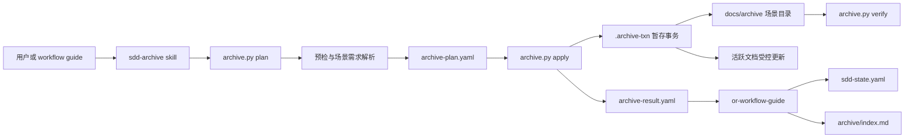
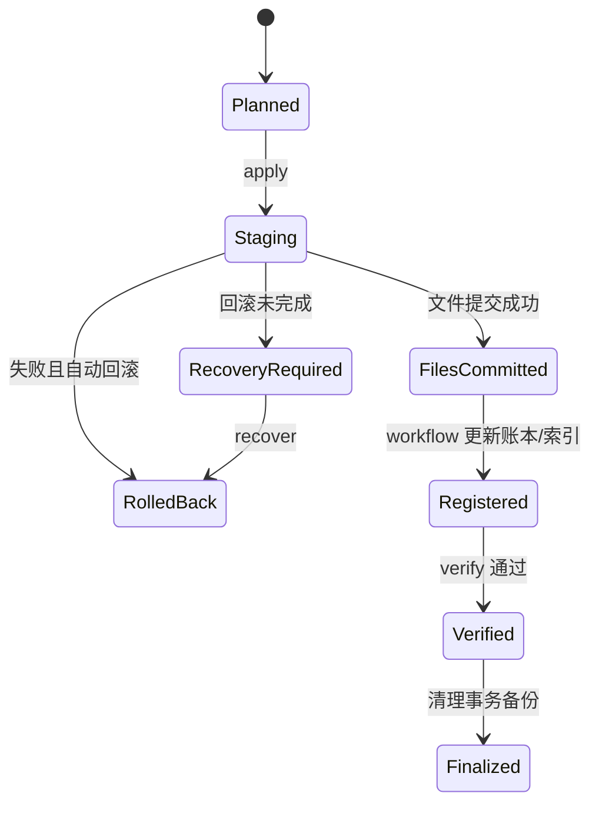

# sdd-archive 落地技术方案

日期：2026-07-10  
状态：Approved，P0/P1/P2/P3 已实施，P4 待实施  
目标技能：`skills/sdd-archive`  
设计类型：`docs-or-process`  
数据库影响：无

## 1. 目标与成功标准

本方案将 `sdd-archive` 从依赖代理临场编辑的操作说明，改造成“脚本执行、skill 编排、workflow 记账”的可恢复归档能力。

成功标准：

1. 默认先执行 dry-run；未通过预检时不修改任何文件。
2. 归档提交要么全部成功，要么可自动恢复到提交前状态，不允许长期停留在半归档状态。
3. 同一场景、同一批输入重复执行不会重复移动文件、重复写索引或重复标记需求。
4. 当前场景的需求集合必须来自显式 ID，不允许归档时通过标题、编号区间或“所有 active 需求”猜测。
5. 归档对 `requirements-baseline.json` 的修改不会被工作流误判为业务规格漂移。
6. manifest 可以校验归档完整性，能够发现文件缺失、内容变化和索引不一致。
7. 旧项目没有场景元数据时只能生成预览；未取得明确映射前不得标记需求 delivered。
8. Linux/macOS、Python 3.10+ 环境下可运行，不新增第三方运行时依赖。

## 2. 范围边界

### 2.1 本期范围

- 新增归档执行脚本、manifest schema、测试 fixture 和一致性检查。
- 调整 `sdd-archive/SKILL.md`，由说明型流程改为调用脚本的编排规程。
- 调整 `or-workflow-guide` 的账本契约，明确归档结果由谁写入。
- 为 baseline 增加不参与业务规格指纹的生命周期元数据处理规则。
- 支持首次归档、重复执行、手工归档、中间状态快照和同场景 iteration。
- 兼容当前 `docs/` 文件布局。

### 2.2 非目标

- 不做远程对象存储、压缩包上传或加密归档。
- 不替代 Git 历史，也不自动提交 Git。
- 不自动删除未知文件。
- 不自动推断旧项目中需求所属场景。
- 不改变四阶段 SDD 的业务门禁定义。

## 3. 方案选择

| 方案 | 描述 | 优点 | 缺点 | 结论 |
|---|---|---|---|---|
| A. 继续纯 skill 指令 | 由代理按 Markdown 说明直接复制、移动和编辑 | 改动最小 | 无事务、不可测、不幂等，现有问题基本不变 | 淘汰 |
| B. 单 Python 脚本直接提交 | 脚本一次执行完预检、归档和写账本 | 实现简单 | 脚本同时拥有文件与工作流状态写权限，耦合仍高 | 不推荐 |
| C. 计划/提交分离的本地事务 | 脚本生成确定性计划并执行文件事务；workflow guide 根据结果更新账本 | 可预览、可恢复、职责清晰、便于测试 | 初期实现量较大 | **采用** |

推荐方案 C。`sdd-archive` 负责归档文件事务，`or-workflow-guide` 是 `sdd-state.yaml` 的唯一写入者。脚本不直接改账本，只读取账本并在结果文件中返回建议补丁。

### 3.1 方案决策记录

| 日期 | 决策 | 状态 | 说明 |
|---|---|---|---|
| 2026-07-13 | 采用方案 C：计划/提交分离的本地事务 | **已批准** | 后续设计与实现以本方案为唯一基线；方案 A、B 不再保留为实施候选 |
| 2026-07-13 | 批准方案 C 的完整详细设计及实施边界 | **已批准** | 第 20 节全部决策生效，可按 P0 → P4 分阶段实施 |
| 2026-07-13 | P0/P1/P2 实施完成 | **已完成** | 只读计划/校验、事务 apply/recover/finalize 已通过 fixture 测试；P3 账本编排尚未接入 |
| 2026-07-13 | P3 实施完成 | **已完成** | register 已实现账本 archives 幂等 upsert、active_scenario 清理和 archive/index.md 全量渲染 |

## 4. 总体架构



### 4.1 模块边界

| 模块 | 建议路径 | 职责 |
|---|---|---|
| CLI | `skills/sdd-archive/scripts/archive.py` | `plan/apply/verify/recover` 命令入口 |
| 文件发现 | `skills/sdd-archive/scripts/archive_core/discovery.py` | 按白名单识别 SDD 产物，拒绝未知文件 |
| 场景解析 | `.../scenario.py` | 校验 slug、显式 requirement IDs、归档类型 |
| 计划生成 | `.../planner.py` | 生成稳定排序的操作计划和预期哈希 |
| 事务执行 | `.../transaction.py` | 暂存、备份、提交、回滚、崩溃恢复 |
| 格式编辑 | `.../editors.py` | JSON/YAML/Markdown 的受控更新 |
| 清单与校验 | `.../manifest.py` | 生成 manifest、完整哈希和一致性验证 |
| schema | `skills/sdd-archive/references/archive-manifest.schema.json` | manifest v1 格式约束 |
| 测试 | `skills/sdd-archive/tests/` | 单元、fixture、故障注入与端到端测试 |

Python 标准库负责文件、JSON、哈希和原子替换。YAML 读写优先复用项目已有依赖；若运行环境无 YAML 库，CLI 应明确失败，不得用正则改写 YAML。实现前需确认 `requirements.txt` 中的 YAML 依赖，并固定解析策略。

## 5. 权威数据与写入权限

### 5.1 单一写入者

| 数据 | 唯一写入者 | 说明 |
|---|---|---|
| 归档目录与 manifest | `archive.py` | 文件事务的一部分 |
| 原位 `brd.md` | `archive.py` | 使用结构化场景标记收敛 |
| 原位 `requirements-baseline.json` | `archive.py` | 仅更新明确 requirement IDs 的生命周期字段 |
| `docs/sdd-state.yaml` | `or-workflow-guide` | 保持现有账本统一管理原则 |
| `docs/archive/index.md` | `or-workflow-guide` | 从账本 `archives[]` 确定性重建，不做追加式手工编辑 |

`archive.py apply` 成功后输出 `archive-result.yaml`。workflow guide 根据结果在一次受控写入中更新 `archives[]`、阶段状态和指纹锚点，然后从账本重新渲染 `archive/index.md`。

若用户直接调用 `sdd-archive`、没有 workflow guide 编排，skill 必须在文件事务成功后显式调用 workflow guide 的账本更新流程；不能让归档结果长期处于未登记状态。

### 5.2 需求归属契约

在 `sdd-state.yaml` 增加活跃场景：

```yaml
active_scenario:
  id: gas-monthly-matching
  name: 月度需供匹配
  requirement_ids: [F-001, F-002, F-003, F-004]
  started_at: "2026-07-01T09:00:00+08:00"
```

规则：

- `requirement_ids` 是归档范围的唯一权威来源。
- 列表中的 ID 必须存在于 baseline，且不得已经属于其他已归档场景。
- CLI 可接受 `--requirements F-001,F-002`，但必须与 `active_scenario.requirement_ids` 一致；不一致即失败。
- 旧项目没有该字段时，`plan` 输出阻断项和候选 ID，禁止 `apply`。
- 禁止使用 F 编号连续区间替代真实 ID 列表，因为编号可能不连续。

## 6. 指纹模型修正

当前 baseline 同时承载业务需求和归档生命周期字段。直接添加 `status/scenario` 会改变文件哈希，从而被误判为业务规格漂移。

采用“双指纹”模型：

1. `content_fingerprint`：业务规格指纹。计算前递归移除以下非业务字段：
   - `requirements[*].status`
   - `requirements[*].scenario`
   - `requirements[*].delivered_at`
   - 顶层 `lifecycle`（若未来增加）
2. `file_fingerprint`：完整文件 SHA-256，只用于归档完整性验证，不参与规格漂移判定。

规范化算法必须固定：UTF-8、JSON key 排序、紧凑分隔符、数组保持原顺序、末尾无换行后计算 SHA-256。算法标识写入 manifest：`canonical-json-v1`。

`sdd-state.yaml` 中各阶段的 `generated_against` 继续记录 `content_fingerprint`。归档修改生命周期字段后，业务指纹应保持不变；若不变则无需触发规格变更。如果变化，归档事务必须失败并回滚，因为这说明脚本意外改动了业务内容。

## 7. 归档数据模型

### 7.1 目录

```text
docs/archive/2026-07-10-gas-monthly-matching/
├── manifest.yaml
├── specs/
├── views/
├── process/
└── evidence/
```

同场景后续迭代使用独立、完整的归档单元：

```text
docs/archive/2026-07-10-gas-monthly-matching/iterations/0001-2026-07-12T103000+0800/
└── manifest.yaml
```

iteration 必须有自己的 manifest 和完整文件清单，不依赖父 manifest 才能解释内容。

### 7.2 manifest v1

```yaml
schema_version: 1
archive_id: "2026-07-10-gas-monthly-matching"
transaction_id: "01J2...ULID"
scenario:
  id: gas-monthly-matching
  name: 月度需供匹配
  requirement_ids: [F-001, F-002, F-003, F-004]
archived_at: "2026-07-10T16:30:00+08:00"
trigger: verification-complete
snapshot_state: complete
source:
  baseline_version: v1.0
  stages:
    code_verification: {status: complete, gate: passed}
fingerprint_policy:
  file: sha256
  content: canonical-json-v1
files:
  - source: docs/ontology_schema.json
    archived: specs/ontology_schema.json
    operation: copy
    size: 18342
    sha256: "完整的 64 位十六进制摘要"
active_mutations:
  - file: docs/requirements-baseline.json
    operation: mark-delivered
    requirement_ids: [F-001, F-002, F-003, F-004]
    before_sha256: "..."
    after_sha256: "..."
    content_fingerprint_before: "..."
    content_fingerprint_after: "..."
ledger_update:
  status: pending
  archive_path: archive/2026-07-10-gas-monthly-matching
```

要求：

- 使用完整 SHA-256，不截断。
- 文件列表逐项记录原路径、归档路径、操作、大小和哈希。
- `snapshot_state` 只有 `preparing | complete`；对外可见的最终目录中只允许 `complete`。
- manifest 禁止包含绝对路径，确保项目可迁移。
- schema 校验失败不得提交。

## 8. BRD 的可解析收敛

仅依赖“§4”标题不足以安全编辑。新生成的 BRD 应加入机器标记：

```markdown
<!-- sdd:scenario id="gas-monthly-matching" requirement_ids="F-001,F-002" -->
### 月度需供匹配
...
<!-- /sdd:scenario -->
```

归档时只替换匹配场景标记内的内容。替换结果为一条摘要块，并保留相同场景 ID，便于幂等检测。

旧 BRD 没有机器标记时：

1. `plan` 给出候选标题和需求 ID；
2. 默认只复制 BRD 快照，不修改原文；
3. 用户或维护者补充标记后再执行收敛；
4. 禁止基于标题模糊匹配直接删除正文。

历史场景索引不再增量编辑 BRD 表格。BRD 中只保留指向 `archive/index.md` 的固定入口，具体列表由账本渲染，避免三份索引同时漂移。

## 9. 文件事务协议

### 9.1 plan 阶段

命令：

```bash
python3 skills/sdd-archive/scripts/archive.py plan \
  --project-root . \
  --trigger verification-complete \
  --output .sdd/archive-plan.yaml
```

plan 必须完成：

- 校验项目根路径和 `docs/` 边界，拒绝符号链接逃逸。
- 读取账本、active scenario、阶段 gate 和 requirement IDs。
- 按固定白名单发现文件；未知文件只报告，不处理。
- 计算所有源文件哈希和目标冲突。
- 模拟 baseline 与 BRD 修改，校验业务指纹不变。
- 输出稳定排序的 `archive-plan.yaml`，其中包含 `plan_hash`。
- 不修改任何项目文件。

### 9.2 apply 阶段

```bash
python3 skills/sdd-archive/scripts/archive.py apply \
  --project-root . \
  --plan .sdd/archive-plan.yaml
```

执行协议：

1. 获取 `.sdd/archive.lock` 排他锁；锁内记录 PID、主机、开始时间和 transaction ID。
2. 重算计划涉及文件的哈希。与 plan 不一致则失败，要求重新 plan。
3. 在 `.sdd/archive-txn/<transaction-id>/` 创建同文件系统暂存区。
4. 将所有归档文件先复制到暂存区，并逐项校验哈希。
5. 在暂存区生成修改后的 BRD、baseline、manifest 和 result。
6. 校验 manifest schema、JSON/YAML 可解析性、业务指纹不变和 requirement ID 覆盖。
7. 将归档暂存目录原子重命名为最终目录。
8. 使用 `os.replace` 原子替换需要修改的活跃文件；替换前的原文件保存在事务备份区。
9. 对“移动”文件，最后才删除源文件；删除前确保其归档副本已校验。
10. 写入 `archive-result.yaml`，标记文件事务完成、账本更新待执行。
11. 释放锁。事务备份保留到 workflow guide 完成账本更新与 verify，之后由 `finalize` 清理。

### 9.3 recover 与 finalize

- `recover --transaction <id>`：读取事务日志。未提交则删除暂存；已部分提交则从备份恢复活跃文件并移除未登记归档目录。
- `finalize --transaction <id>`：仅在账本已登记且 verify 通过后清理备份。
- 启动任何新归档前必须检查未完成事务。有未完成事务时禁止新建事务。

说明：多个文件之间无法依靠普通文件系统重命名获得真正的跨文件 ACID。本方案通过“同文件系统暂存 + 原子替换 + 持久事务日志 + 可回滚备份”实现可恢复提交，而不是虚假承诺绝对原子性。

## 10. CLI 契约

```text
archive.py plan     生成只读计划
archive.py apply    按 plan_hash 执行文件事务
archive.py verify   校验归档、账本和索引一致性
archive.py recover  恢复未完成事务
archive.py finalize 清理已验证事务备份
```

通用退出码：

| 退出码 | 含义 |
|---|---|
| 0 | 成功 |
| 2 | 参数或 schema 错误 |
| 3 | 前置门禁未满足 |
| 4 | 输入自 plan 后发生变化 |
| 5 | 目标冲突或幂等冲突 |
| 6 | 文件事务失败，已回滚 |
| 7 | 文件事务失败，需要 recover |
| 8 | verify 发现不一致 |

所有命令同时输出人读摘要和机器可读 YAML/JSON；skill 只能根据机器结果决定后续动作，不能解析终端自然语言。

## 11. 状态机与幂等规则



幂等键：`scenario.id + baseline_version + sorted(requirement_ids) + trigger + source file hashes`。

- 幂等键相同且归档已 verified：返回已有结果，不重复写入。
- 场景相同但源哈希不同：必须显式使用 `--iteration`。
- 目标目录存在但 manifest 缺失或未完成：视为损坏冲突，禁止覆盖。
- index 始终从账本全量渲染，因此重复执行不会追加重复行。
- baseline 中目标需求均已 delivered 且归档记录匹配：视为已完成。
- 部分需求已 delivered：视为不一致，必须先 verify/recover，不允许“补着归档”。

## 12. 门禁与触发规则

| trigger | 允许条件 | 行为 |
|---|---|---|
| `verification-complete` | `code_verification.status=complete` 且 `gate=passed` | 正式交付归档，标记 delivered |
| `new-scenario` | 上一场景满足正式交付门禁 | 先归档，再由 workflow 建立新 active scenario |
| `manual` | 用户明确要求 | 若验证未通过，只允许中间快照，不标记 delivered |
| `iteration` | 场景已有正式归档且明确指定 iteration | 建独立 iteration 快照，不重复标记 delivered |

取消“用户确认即可等同 gate passed”的模糊规则。用户可以强制保存中间快照，但不能借此把未验证需求标成 delivered。若确实需要带风险交付，应先由 workflow guide 将验证阶段记录为符合既有规则的 `waived`，并保留风险与补救信息。

## 13. workflow guide 集成

文件事务成功后，workflow guide 执行：

1. 读取并校验 `archive-result.yaml` 与归档 manifest。
2. 在 `sdd-state.yaml.archives[]` 按 `archive_id` upsert，不做盲目 append。
3. 正式交付时清空 `active_scenario`；中间快照保持不变。
4. 归档本身不自动重置下一场景 stages。只有新场景真正创建时才执行重置和 baseline version 递增。
5. 从账本全量重建 `docs/archive/index.md`。
6. 原子写回账本和 index；若其中一步失败，保留事务供重试，不能 finalize。
7. 调用 `archive.py verify`；通过后调用 `finalize`。

需要同步修改 `state-ledger.md`：明确 `archives[]` 的唯一键、active scenario 结构、upsert 规则以及 content fingerprint 算法。

## 14. verify 规则

`verify` 至少检查：

- manifest 符合 schema，`snapshot_state=complete`。
- manifest 中每个文件存在，大小和完整 SHA-256 一致。
- 不存在 manifest 未声明的归档文件，允许的系统文件除外。
- baseline 中 manifest 的 requirement IDs 状态与 trigger 一致。
- baseline 生命周期变更前后 `content_fingerprint` 一致。
- 账本存在唯一对应 archive 记录，路径、版本、trigger 一致。
- `archive/index.md` 是当前账本的确定性渲染结果。
- 正式归档后 active scenario 已清理；中间快照仍保留。
- BRD 场景块已收敛或被明确记录为 `legacy-not-collapsed`。
- 没有悬挂事务、过期锁或部分 delivered 状态。

验证结果分为：`passed`、`failed-recoverable`、`failed-manual`。任何失败都不得清理事务备份。

## 15. 安全约束

- 文件发现采用显式白名单和 glob 配置，不使用“移动 docs 下所有匹配文件”的宽泛策略。
- 所有解析后的路径必须位于项目根目录内；拒绝 `..`、绝对路径和越界符号链接。
- 不跟随归档源文件中的符号链接。
- 目标文件已存在时绝不覆盖，除非验证为相同幂等归档。
- 未知用户文档只报告，不复制、不移动、不删除。
- 删除源文件前必须完成归档副本 fsync 和哈希校验。
- 日志不得写入文件正文或环境变量内容，只记录相对路径、操作和摘要。

## 16. 测试方案

### 16.1 单元测试

- slug 规范化与非法路径输入。
- baseline content fingerprint 忽略生命周期字段但识别业务字段变化。
- requirement ID 精确筛选、缺失、重复和跨场景冲突。
- manifest 生成、schema 校验和稳定排序。
- BRD 标记块收敛及重复收敛。
- index 从账本确定性渲染。

### 16.2 集成测试

至少准备以下 fixture：

1. 完整四阶段产物首次归档。
2. 缺少可选派生视图。
3. 旧项目无账本。
4. 旧 baseline 无 scenario 信息。
5. 目标目录已存在。
6. 同一归档重复执行。
7. 同场景 iteration。
8. 手工中间快照，不标 delivered。
9. 源文件在 plan 后被修改。
10. BRD 无机器标记。

### 16.3 故障注入

在每个提交点模拟异常：复制中断、manifest 写入失败、归档目录重命名后失败、baseline 替换后失败、账本写入失败。每个用例必须证明：

- 自动回滚后与执行前文件哈希一致；或
- `recover` 能确定性恢复；
- 不会丢失唯一副本；
- 下一次运行能识别未完成事务，而不是创建第二个归档。

### 16.4 验收门禁

- 所有单元和集成测试通过。
- 故障注入覆盖每个持久化提交点。
- 在一个复制的真实 `docs/` 样本上完成 `plan -> apply -> ledger update -> verify -> finalize`。
- 对同一输入连续运行两次，第二次无文件差异。
- 归档前后业务 content fingerprint 完全一致。

## 17. 分阶段实施计划

### P0：先修协议冲突

1. 明确 workflow guide 为账本和 index 唯一写入者。
2. 增加 `active_scenario.requirement_ids`。
3. 定义 baseline content fingerprint，并调整漂移检测。
4. 修改 `sdd-archive/SKILL.md`：未验证只能做中间快照，不能标 delivered。

交付物：更新后的 skill/reference 文档与 schema 草案。此阶段不启用破坏性自动执行。

### P1：实现只读 plan/verify

1. 实现 discovery、scenario、fingerprint、manifest schema。
2. 实现 `plan`，默认 dry-run。
3. 实现只读 `verify` 和测试 fixture。

交付物：可以发现所有冲突，但仍不移动或改写文件。

### P2：实现可恢复 apply

1. 实现锁、暂存区、事务日志、备份、原子替换。
2. 实现 baseline 和带机器标记 BRD 的受控修改。
3. 实现 recover/finalize 与故障注入测试。

交付物：文件事务可在复制项目上安全执行。

### P3：集成 workflow guide

1. 实现账本 upsert、active scenario 清理和 index 全量渲染。
2. 串联完整生命周期。
3. 为旧项目增加迁移检查和人工映射流程。

交付物：正式替代旧的手工归档流程。

### P4：稳定运行后清理旧规则

1. 删除 SKILL.md 中重复、矛盾的手工复制/移动细节。
2. 保留行为边界、硬门禁、CLI 调用和失败处置。
3. 补充维护手册和常见恢复案例。

## 18. 文件改动清单

计划新增：

```text
skills/sdd-archive/scripts/archive.py
skills/sdd-archive/scripts/archive_core/*.py
skills/sdd-archive/references/archive-manifest.schema.json
skills/sdd-archive/references/archive-plan.schema.json
skills/sdd-archive/references/recovery-runbook.md
skills/sdd-archive/tests/**
```

计划修改：

```text
skills/sdd-archive/SKILL.md
skills/or-workflow-guide/SKILL.md
skills/or-workflow-guide/references/state-ledger.md
skills/or-workflow-guide/references/sdd-state.example.yaml
skills/ontology-modeling/references/requirements-gate.md
skills/ontology-modeling/references/brd-template.md
skills/code-verification/SKILL.md
```

`code-verification` 只需明确 delivered 的判定依赖已登记且 verified 的正式归档，不能仅看 baseline 中一个孤立的 `status: delivered`。

## 19. 风险与取舍

| 风险 | 影响 | 缓解 |
|---|---|---|
| 多文件操作无法获得真正 ACID | 崩溃时可能部分提交 | 事务日志、备份、recover，文档不虚假承诺原子性 |
| baseline 指纹算法变化 | 旧账本指纹不兼容 | 增加算法版本；首次运行迁移并同时保存旧值用于审计 |
| 旧 BRD 没有机器标记 | 无法安全自动收敛 | 只快照不改原文，先人工补标记 |
| YAML round-trip 改变格式或注释 | 产生噪声 diff | 固定 YAML 库和写入策略；关键账本尽量局部、原子更新并做 golden test |
| 账本更新晚于文件事务 | 短时间存在未登记归档 | result 状态 + 未完成事务扫描；未登记前禁止新归档 |
| 实现复杂度高于原说明 | 初期维护成本上升 | 分 P0-P4 交付，先做只读 plan/verify，再开放 apply |

## 20. 审批结论

以下设计决策已于 2026-07-13 全部批准：

1. 采用“Python CLI + 可恢复文件事务”，不再依赖代理直接搬运文件。
2. `or-workflow-guide` 是 `sdd-state.yaml` 和 `archive/index.md` 的唯一写入者。
3. 在账本增加 `active_scenario.requirement_ids`，归档禁止推断需求归属。
4. baseline 使用业务 `content_fingerprint` 与完整 `file_fingerprint` 双指纹。
5. 未通过验证的手工归档只能保存中间快照，不能标记 delivered。
6. BRD 自动收敛依赖机器标记；旧文档默认不做破坏性改写。
7. 按 P0 → P1 → P2 → P3 → P4 分阶段实施，P1 验证通过前不开放文件移动。

设计门禁已通过。下一步应先实施 P0 协议修订和 P1 只读 `plan/verify`，不要直接编写 `apply`。
