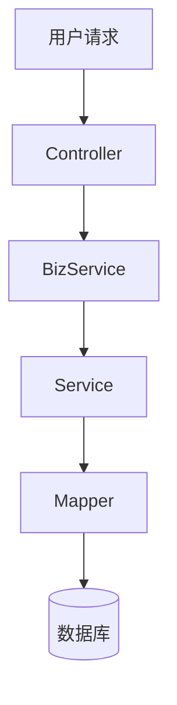

# 阶段3：按模块生成知识文件

把模块知识写成**每模块一个 markdown 文件**，按章节规划放入对应章节目录，统一知识维度章节 + frontmatter + 关系段。最后生成 `总览.md` 章节树总览。

## 拆分规则（核心：章节目录布局，中文文件名）

- **模块树每个模块一个文件**：`docs/wiki/<章节名>/<模块中文名>.md`。一个模块一份知识，**不按文章类型聚合多模块**。
- **章节目录布局**：
  - 章节 = 物理目录，按 `.章节树.md` 中的规划创建
  - 章节可嵌套（最多 2 层）：`docs/wiki/<根章节>/<子章节>/<模块中文名>.md`
  - 每个章节目录含 `_简介.md`（章节简介）
  - 特殊根章节：`仓库级约定/` 存放 6 个跨切面类别文件
- **中文文件名规则**：
  - 文件名 = 模块的业务含义中文名，让人一眼看出模块功能
  - 长度：3-20 个汉字，避免过短（无意义）或过长（啰嗦）
  - 示例：
    - `数据访问层.md`（不用 `src-data-layer`）
    - `API路由与控制器.md`（不用 `api-controllers`）
    - `技能注册中心.md`（不用 `skill-registry`）
    - 根模块用项目名，如 `燃气智能体平台.md`
  - 同一 repo 内文件名全局唯一（跨章节不重名）
- **文件名与 总览.md 中的显示名一致**：总览.md 用 `[显示名](相对路径不含后缀)` 链接
- **噪音模块显式排除**：审计基类、日志表、纯技术中间件、build 产物目录不生成文件，在 `.模块树.md` 标注排除。

> 为什么要坚持中文文件名：中文文件名让维护者在文件管理器或编辑器中一目了然地定位模块，不需要在英文 slug 和中文理解之间做心智映射。
> 为什么要按章节组织：章节按业务领域划分，让维护者按主题浏览，而不是面对一个扁平的大文件列表。

## 自底向上生成顺序

- **叶子模块先写**（无子模块）：基于模块知识 + read_file 验证，直接产出 frontmatter + 知识维度章节 + `## 关系`。
- **父模块后写**（有子模块）：`## 架构设计` 可综合其子模块的职责分工，但**不复制子模块正文**——引用子模块文件即可。
- **root 模块最后写**：综合全仓顶层架构。
- **简介.md 先于模块文件写**：每个章节目录先写 `简介.md`，再写该章节下的模块文件。
- 父模块的 `## 关系` 不列父子关系（由 总览.md 层级表达），只列跨模块依赖/被依赖/相关边。

## 简介.md（章节简介）

每个章节目录含一个 `简介.md`，简要说明该章节的业务领域、覆盖范围和技术栈：

```markdown
---
title: "<章节中文名>"
description: "<章节业务概述，1-2 句>"
module_count: <该章节下模块文件数>
---

# <章节中文名>

<章节业务概述段落：说明该章节覆盖的业务领域、包含哪些核心模块、各模块之间的协作关系。2-4 段。>

## 技术栈

<该章节下模块共用的技术栈、框架、库。例如：Spring Boot 3.4.5、MyBatis、RocketMQ 等。
模块文件不再重复列出这些共用技术栈，只在本章节统一说明。>

## 本章节模块

- [<模块显示名>](<模块文件名.md>) — <模块一句话业务描述>
- [<模块显示名>](<模块文件名.md>) — <模块一句话业务描述>
```

### 简介.md frontmatter 字段

| 字段 | 必填 | 说明 |
|---|---|---|
| `title` | ✅ | 章节中文名，与目录名一致 |
| `description` | ✅ | 章节业务概述，1-2 句 |
| `module_count` | ✅ | 该章节下模块文件数（不含 `简介.md`） |

> **技术栈上移原则**：同一项目内各模块通常共用相同的技术栈（如 Spring Boot、MyBatis），为避免在每个模块文件中重复列出，技术栈统一在章节 `简介.md` 中说明。模块文件仅在引入**模块特有**的额外技术栈时才写 `## 技术栈` 段。

## 每文件结构

```markdown
---
description: "<一句话业务概述，与模块树描述一致>"
module_id: "<稳定身份，用模块路径或其 hash>"
section: "<所属章节中文名>"
---

# <模块中文显示名>

## 概述 <!-- category:overview -->
<模块的业务功能与职责定位，1-3 段。从 description 展开，说明这个模块解决什么问题、提供什么能力。
**不是文件路径枚举**。提及源文件时用 inline 引用如 `manager.py` 的配置加载功能。>

## 架构设计 <!-- category:architecture_design -->
<主信号。架构风格、设计模式、分层策略、核心抽象、模块间协作方式。
用 inline 源文件引用佐证，如 "service/ 下采用策略模式实现不同算法"、"通过 MQ 消息解耦调用方"。
**不要逐条列出目录下的每个文件**——说清楚设计意图和关键抽象即可。>

**必须包含 Mermaid 图**：每篇模块文件的 `## 架构设计` 至少包含一张 Mermaid 图，用于可视化展示架构、流程或关系。根据模块特性选择合适的图类型：

| 图类型 | 适用场景 | 示例 |
|---|---|---|
| `graph TD`（流程图） | 数据流、处理流程、状态转换 | 请求处理流程、数据同步流程 |
| `sequenceDiagram`（时序图） | 组件间交互、调用链路 | API 调用时序、消息传递流程 |
| `classDiagram`（类图） | 类结构、继承关系、接口实现 | 服务层类结构、实体关系 |
| `erDiagram`（ER 图） | 数据模型、表结构 | 数据库表关系 |
| `flowchart`（架构图） | 系统架构、模块依赖 | 分层架构、组件关系 |

图必须：
- 使用 `graph TD`（自上而下）方向，不使用 `graph LR`
- 节点文字简洁（3-4 个词以内）
- 准确反映源码中的实际结构，不臆造
- 图前后有简要文字说明

示例：



## 技术栈 <!-- category:tech_stack -->
<**可选**。仅当模块引入了章节 `_简介.md` 未提及的额外技术栈时才写此节。
例如：章节共用 Spring Boot + MyBatis，但本模块额外引入了 Redis 缓存，则在此说明 Redis。
若模块技术栈与章节一致，则跳过此节，不重复列出。>

## 编码规范 <!-- category:coding_conventions -->
<**可选**。仅当模块有独特的编码约定或模式时才写此节。
通用的命名规范、代码风格已在 `仓库级约定/` 中统一说明，此处不重复。>

## 配置与命令 <!-- category:unique_setup_and_commands -->
<**可选**。特殊配置项、环境变量、安装部署命令。无则跳过此节。>

## 关系
- **依赖**：[<被依赖模块显示名>](<跨章节相对路径.md>)  <可选说明>
- **被依赖**：[<依赖本模块的模块显示名>](<跨章节相对路径.md>)
- **相关**：[<语义邻居模块显示名>](<跨章节相对路径.md>)  <可选说明>
```

### frontmatter 字段

| 字段 | 必填 | 说明 |
|---|---|---|
| `description` | ✅ | 一句话业务概述，与模块树描述一致 |
| `module_id` | ✅ | 稳定身份，文件可改名而 id 不变；用模块路径或其 hash |
| `section` | ✅ | 所属章节中文名，与章节目录名一致 |

> 不包含 `source_files` 字段——模块文件正文中仅用 inline 引用提及关键源文件，不单独列出路径清单。`source_files` 信息保留在 `.module-tree.md` 工作基线中供追溯。

### 知识维度章节

| 章节 | category 注释 | 必填 | 内容 |
|---|---|---|---|
| `## 概述` | `overview` | ✅ | 模块的业务功能与职责定位，**非文件路径列表** |
| `## 架构设计` | `architecture_design` | ✅ | **主信号**：设计意图、分层策略、核心抽象、协作方式。**必须包含至少一张 Mermaid 图** |
| `## 技术栈` | `tech_stack` | ❌ | **仅模块特有技术栈**。共用技术栈已在章节 `_简介.md` 说明，此处不重复 |
| `## 编码规范` | `coding_conventions` | ❌ | **仅模块独特约定**。通用规范已在 `仓库级约定/` 说明，此处不重复 |
| `## 配置与命令` | `unique_setup_and_commands` | ❌ | 配置/安装/命令；无则跳过 |
| `## 关系` | — | ❌ | 三向邻居；无跨模块边则跳过 |

- HTML 注释 `<!-- category:x -->` 保留在标题后，供程序化解析知识维度。
- **概述** 与 **架构设计** 必有；其余有内容才写、无则跳过（不留空节）。
- **技术栈/编码规范上移原则**：同一项目内各模块通常共用相同的技术栈和编码规范，为避免重复，这些信息统一在章节 `_简介.md` 或 `仓库级约定/` 中说明。模块文件仅在引入**模块特有**的额外技术栈或编码规范时才写对应章节。
- 正文提及源文件用 **inline 引用**（`` `manager/` ``、`` `service/iop/` ``、`` `ApplicationRunner.java` `` 的配置加载），不用 `[file:L-L](file://...)` 严格引用块——这是模块知识文件，不是源码逐行分析。
- **概述段落严禁出现**：`source_files: [...]`、文件路径列表、目录树。

### `## 关系` 段

- 三向：**依赖**（本模块 depends_on 谁）/ **被依赖**（谁 depends_on 本模块）/ **相关**（related_to，LLM 推断的语义邻居）。
- 每向一行列一个邻居模块，链接到其文件路径（**含 `.md` 后缀**）：
  - **同章节模块**：直接写文件名，如 `[数据访问层](数据访问层.md)`
  - **跨章节模块**：用相对路径，如 `[匹配引擎](../核心功能/匹配引擎.md)` 或 `[整体架构](../系统架构/整体架构.md)`
- **父子关系不列**——由 `总览.md` 层级表达。
- 无跨模块边则跳过整个 `## 关系` 段。

示例：

```markdown
## 关系
- **依赖**：[匹配引擎与定价](../核心功能/匹配引擎与定价.md)  调用算法与定价服务
- **被依赖**：[异步流程与消息驱动](../核心功能/异步流程与消息驱动.md)  消费匹配结果消息
- **相关**：[AI 报告生成](../核心功能/AI报告生成.md)  共享匹配版本数据
```

## 总览.md（章节树总览）

最后生成 `docs/wiki/总览.md`：

```markdown
---
title: "<项目名> 仓库知识库"
description: "<项目> 的模块知识库；全中文，按业务章节分层组织，每模块一个文件。"
generated_at: "<ISO8601>"
module_count: <N>
section_count: <N>
---

# <项目名> 仓库知识库

## 格式说明
- 按业务章节分层组织，章节 = 物理目录，每章节下含若干模块 markdown 文件。
- 每个模块文件含 frontmatter + 知识维度章节（概述/架构设计/技术栈/编码规范/配置与命令）+ ## 关系。
- 每个章节目录含 `简介.md` 章节简介。
- 父子层级见下方"章节树总览"；跨模块依赖见各文件 ## 关系段。

## 章节树总览

### [概览](概览/简介.md)
项目概述、快速上手、核心概念入门

- [项目概述](概览/项目概述.md) — <项目整体功能定位与核心价值>
- [快速上手](概览/快速上手.md) — <安装部署与环境配置指南>

### [系统架构](系统架构/简介.md)
系统整体设计、分层策略、核心抽象与模块间协作

- [整体架构](系统架构/整体架构.md) — <系统分层设计与核心抽象>
  - [数据流与状态管理](系统架构/数据流与状态管理.md) — <数据在系统中的流转路径>

### [核心功能](核心功能/简介.md)
主要业务功能模块

- [匹配引擎与定价](核心功能/匹配引擎与定价.md) — <燃气供需匹配核心算法编排>
- [技能注册中心](核心功能/技能注册中心.md) — <可插拔 AI 技能的注册与路由>
- [AI 报告生成](核心功能/AI报告生成.md) — <基于匹配结果自动生成分析报告>

### [数据管理](数据管理/简介.md)
数据访问、存储、缓存

- [数据访问层](数据管理/数据访问层.md) — <统一数据访问抽象与 ORM 映射>

### [部署与基础设施](部署与基础设施/简介.md)
构建、部署、CI/CD

- [构建与部署](部署与基础设施/构建与部署.md) — <构建工具链与部署流程>

### [仓库级约定](仓库级约定/简介.md)
构建/配置/依赖/异常/日志/前端 6 类别

- [构建系统](仓库级约定/构建系统.md) — <构建工具链与流程>
- [配置系统](仓库级约定/配置系统.md) — <配置体系（多环境/配置中心）>
- [依赖管理](仓库级约定/依赖管理.md) — <依赖声明与版本策略>
- [异常处理](仓库级约定/异常处理.md) — <异常处理（统一异常/错误码/AOP）>
- [日志系统](仓库级约定/日志系统.md) — <日志框架与输出>
- [前端风格](仓库级约定/前端风格.md) — <前端框架与样式>
```

- **按章节分组展示**：每个根章节一个 H3 标题 + 章节链接 + 章节描述段落 + 模块列表。
- **描述聚焦业务功能**：每个模块的 `— <描述>` 部分说明模块的能力，不是存放路径。
- 子章节嵌套在父章节模块列表下，用缩进表达。
- 每项 = `[显示名](相对路径.md)` + ` — ` + 一句业务描述（**链接含 `.md` 后缀**）。
- `仓库级约定/` 作为特殊根章节，列出 6 个跨切面类别文件。

## 准出（阶段3）

- 模块树每个非噪音模块有对应 `docs/wiki/<章节名>/<中文文件名>.md`。
- 文件名全中文，3-20 汉字。
- 每个模块文件有 `section` frontmatter 字段，值与所在章节目录名一致。
- 每文件有 `## 概述`（业务描述，非路径清单）+ `## 架构设计`。
- `## 关系` 段（如有）三向用相对路径链接到其他模块文件，不含父子关系。
- 每个章节目录含 `简介.md`。
- `总览.md` 按章节分组展示全部模块文件链接。
